# Integrations-Cockpit: technical documentation

*Audience: software developers who maintain or extend the application.*
*Language versions: English (this file) · [Română](../ro/documentatie-tehnica.md)*

Related manuals: [Installation and configuration](installation.md) · [User manual](user-manual.md)

---

## Contents

1. [Purpose and scope](#1-purpose-and-scope)
2. [Technology stack](#2-technology-stack)
3. [Architecture overview](#3-architecture-overview)
4. [Module reference](#4-module-reference)
5. [Data model](#5-data-model)
6. [End-to-end data flow](#6-end-to-end-data-flow)
7. [Ingest: from arbitrary Excel files to canonical tables](#7-ingest-from-arbitrary-excel-files-to-canonical-tables)
8. [The person base](#8-the-person-base)
9. [Goal evaluation](#9-goal-evaluation)
10. [Cockpit matrix and call list](#10-cockpit-matrix-and-call-list)
11. [Level 2: pattern analysis](#11-level-2-pattern-analysis)
12. [Situationsanalyse: free text to features](#12-situationsanalyse-free-text-to-features)
13. [Excel export](#13-excel-export)
14. [The Streamlit application](#14-the-streamlit-application)
15. [Rules and configuration](#15-rules-and-configuration)
16. [Synthetic data generator](#16-synthetic-data-generator)
17. [Tests](#17-tests)
18. [Privacy and security design](#18-privacy-and-security-design)
19. [Demo video pipeline](#19-demo-video-pipeline)
20. [Extending the application](#20-extending-the-application)
21. [Known limitations](#21-known-limitations)

---

## 1. Purpose and scope

The Asylsozialdienst (ASD) of the City of Bern is paid per refugee who reaches one of three
integration goals by a deadline. The case-management system can produce eleven Excel
exports, and nobody has a combined view of who is on track. The Integrations-Cockpit:

- reads those exports **as they are**: any file name, German headers, Swiss date formats;
- evaluates each of the three goals per person (or per household) against a reference date,
  the **Stichtag**, and assigns a traffic-light status;
- combines the three goals into one matrix and a prioritised **call list** for each social
  worker;
- reports **data-quality issues**, including goals reached but never recorded (lost revenue);
- describes **patterns** (level 2) among people who reached a goal on time, on group level only;
- turns free-text *Situationsanalyse* reports into structured features, with keyword rules or
  a **local** LLM;
- writes everything back out as one formatted Excel workbook.

It is a prototype built during a hackathon. The code base is small: about 2,100 lines of
Python in `app.py`, `cockpit/` and `synth/`. It has no database, no server-side state and no
network dependency beyond an optional local Ollama instance.

## 2. Technology stack

| Layer | Technology | Version | Used for |
|---|---|---|---|
| Language | Python | 3.12 | Everything except the video tooling |
| UI | [Streamlit](https://streamlit.io) | 1.67.0 | Single-page web UI, widgets, caching, file upload/download |
| Data | pandas | 3.1.1 | All tabular processing |
| Excel I/O | openpyxl | 3.1.5 | Reading exports (via pandas), writing and styling the result workbook |
| Charts | Altair | 6.3.0 | Level-2 group chart with confidence intervals |
| Config | PyYAML | 6.0.3 | `rules.yaml` |
| Documents | python-docx 1.2.0, pypdf 7.1.1 | | Generating synthetic `.docx` reports; reading `.pdf` reports |
| LLM client | requests | 2.34.2 | HTTP calls to Ollama |
| LLM runtime | [Ollama](https://ollama.com) + `qwen3:4b` | | Optional, local feature extraction |
| Tests | pytest | 9.2.0 | 54 test cases |
| Video tooling | Node.js, Chrome DevTools Protocol, edge-tts, ffmpeg (imageio-ffmpeg), Remotion | | Generating the pitch video; not needed to run the app |

`.docx` files are read **without** python-docx: the reader opens the ZIP and walks
`word/document.xml` directly (see [section 12](#12-situationsanalyse-free-text-to-features)).
python-docx is only used by the synthetic generator.

## 3. Architecture overview

The application is a **single-process, in-memory pipeline** behind a Streamlit UI. Every
interaction makes Streamlit re-run `app.py` from top to bottom. Expensive steps are memoised
with `st.cache_data`, keyed on the uploaded bytes and the Stichtag.

### 3.1 System context

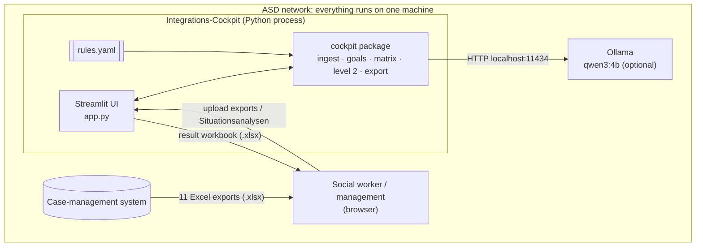

There is no connection to the case-management system. Data enters by **upload** and leaves by
**download**, in both cases as Excel files. Nothing is persisted on the server. The one
exception is the optional JSONL cache of the command-line LLM extraction, which stores
extracted labels and no source text.

### 3.2 Layers and module dependencies

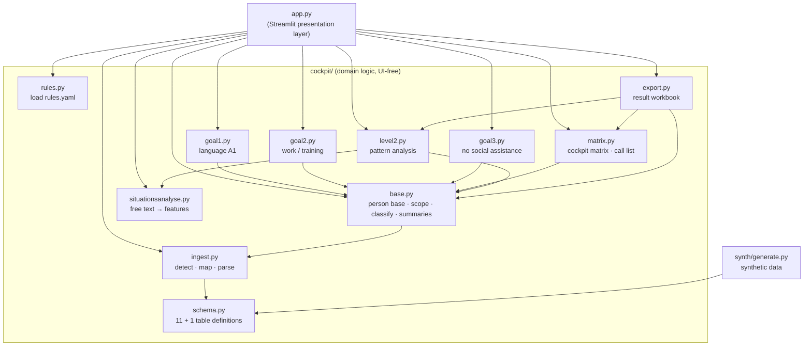

The `cockpit` package has **no Streamlit import**. Every function takes DataFrames and a rules
dict and returns DataFrames or dataclasses. This keeps the logic testable with plain pytest and
reusable from the command line. Only `app.py` knows about widgets, caching and session state.

### 3.3 Key design decisions

| Decision | Reason |
|---|---|
| Excel in, Excel out | The users already work in Excel and the source system only exports Excel. No integration project is needed. |
| Files recognised by **columns**, not by name | Export file names are not stable; column headers are. |
| All open business rules in `rules.yaml` | The challenge text leaves several rules ambiguous. Each one is a setting, so a clarification needs no code change. |
| Stateless, in-memory processing | No personal data at rest, nothing to secure or delete. |
| Group-level output only for patterns | Avoids profiling individuals; minimum group size 10. |
| Local LLM only | Free-text reports contain sensitive personal information and must not leave the network. |
| Domain logic free of UI code | Testability; the same functions back the CLI and the UI. |

## 4. Module reference

| Module | Lines | Responsibility | Main entry points |
|---|---|---|---|
| `cockpit/schema.py` | 213 | Declares the 11 export tables (+ the Situationsanalyse feature table): canonical field → accepted header aliases, signature fields, date fields | `TABLES`, `KEY_COLUMNS`, `export_headers()` |
| `cockpit/ingest.py` | 206 | Reads workbooks, detects each sheet's table, maps headers, cleans keys, parses dates, checks referential integrity | `load_exports()`, `load_directory()`, `LoadResult`, `Issue` |
| `cockpit/rules.py` | 17 | Reads and parses `rules.yaml` | `read_rules_text()`, `rules_from_text()`, `load_rules()` |
| `cockpit/base.py` | 246 | Shared building blocks: one row per client, status, entry date, responsibility end, scope, traffic light, summaries | `prepare_persons()`, `apply_scope()`, `classify()`, `finish()`, `restrict()`, `GoalResult` |
| `cockpit/goal1.py` | 103 | Goal 1: language A1 within 3 years of entry | `evaluate_goal1()` |
| `cockpit/goal2.py` | 168 | Goal 2: 6 months of ≥ 60 % work, or Sek II / tertiary education | `evaluate_goal2()`, `qualifying_runs()` |
| `cockpit/goal3.py` | 128 | Goal 3: household 12 months without social assistance | `evaluate_goal3()`, `free_spells()`, `household_heads()` |
| `cockpit/matrix.py` | 86 | Joins the three goals per person, priority, call list | `cockpit_matrix()`, `call_list()`, `matrix_table()` |
| `cockpit/level2.py` | 231 | Group comparisons, Wilson intervals, Cramér's V, feature combinations | `analyse()`, `Level2Result` |
| `cockpit/situationsanalyse.py` | 296 | Parses reports, removes personal data, extracts 5 features by rules or LLM; also a CLI | `extract_documents()`, `extract_rules()`, `extract_llm()`, `evaluate()` |
| `cockpit/export.py` | 111 | Builds the styled result workbook | `build_workbook()`, `unit_table()` |
| `app.py` | 314 | Streamlit UI | run with `streamlit run app.py` |
| `synth/generate.py` | 507 | Synthetic exports and reports with a planted pattern and deliberate data errors | `python -m synth.generate` |

## 5. Data model

The eleven exports are linked by three keys. Some tables carry only the federal **Zemis
number**; `base.with_client()` translates it into the internal **Klientennummer** through the
`Klient` table. The **Dossier-Nr.** groups people into a household (*Unterstützungseinheit*).

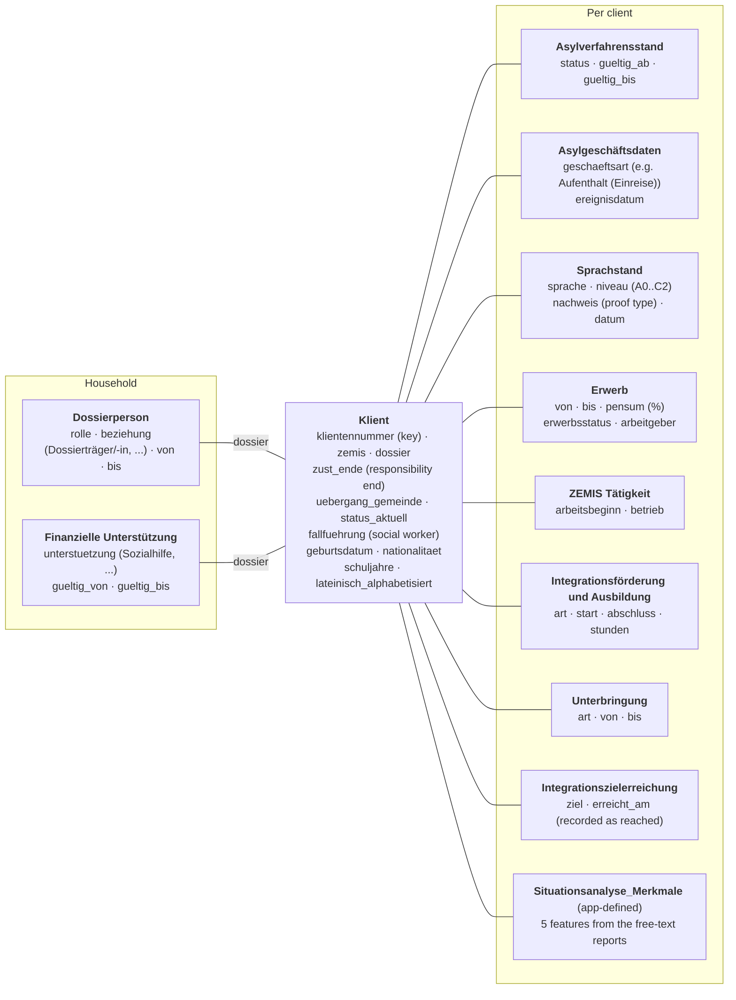

One household (dossier) has several clients; each client has any number of rows in the
tables on the right, linked by Klientennummer or Zemis-Nr. Each box lists the most important
fields only; [`cockpit/schema.py`](../../cockpit/schema.py)
holds the full list with every accepted header spelling. Six exports came with a template from
the challenge organisers (`template_received: True`). The other five (Klient, Sprachstand,
Integrationsförderung, Integrationszielerreichung, Unterbringung) were derived from the data
model in [`doc/datenmodell.html`](../datenmodell.html) and must be checked against real
exports.

`situationsanalyse_merkmale` is a twelfth, app-defined table. It holds the output of the
free-text extraction after a person has reviewed it, and is uploaded like any other export.

## 6. End-to-end data flow

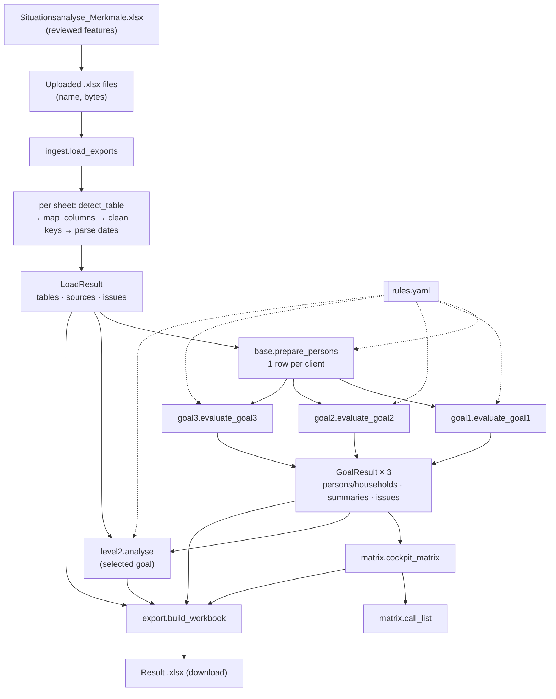

The pipeline has one direction: no step writes back into an earlier one. Each step adds
`Issue` objects (severity `Fehler` / `Warnung` / `Info`); the UI concatenates and
de-duplicates them into the *Datenqualität* (data quality) tab.

## 7. Ingest: from arbitrary Excel files to canonical tables

`ingest.load_exports(files)` accepts a list of `(name, bytes)` pairs and returns a
`LoadResult(tables, sources, issues)`.

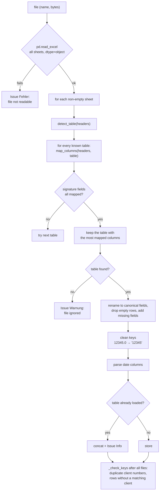

**Header mapping** (`map_columns`) runs in two passes:

1. **Exact match** after normalisation: lower case, punctuation turned into spaces, whitespace
   collapsed; umlauts, `ß` and `%` are kept.
2. **Prefix match** for headers that carry an explanatory suffix, e.g.
   `Geburtsdatum (für «ab 16 J.»)`. Only aliases longer than 5 characters qualify, and the
   longest matching alias wins.

Each canonical field is assigned at most once. Unknown columns are reported as `Info` and
dropped.

**Table detection** (`detect_table`) requires every *signature* field of a table to be mapped,
for example `zust_ende` + `geburtsdatum` for `Klient`. Among the candidates the table with the
most mapped columns wins. This tells apart exports that share generic headers such as `Von`,
`Bis` and `Art`.

**Dates** (`parse_date`) accept, in this order: pandas/Python date objects; Excel serial
numbers between 10,000 and 80,000; and the strings `dd.mm.yyyy`, `dd.mm.yy`, `yyyy-mm-dd`,
`yyyy-mm-dd HH:MM:SS` and `dd/mm/yyyy`. An unparseable value becomes `NaT` and produces one
`Warnung` per column, with up to three sample values. Three exports deliver dates as text and
the rest as Excel dates; both paths are exercised by the synthetic data.

**Keys** (`klientennummer`, `zemis`, `dossier`) are normalised to strings. Excel often turns
`12345` into `12345.0`, which would otherwise break every join.

**Several files or sheets for one table** are concatenated, and the `sources` entry lists all
of them.

## 8. The person base

`base.prepare_persons(tables, rules, stichtag)` builds the DataFrame every goal starts from:
one row per Klientennummer, indexed by it.

| Derived column | How |
|---|---|
| `verfahrensstand` | `Klient.status_aktuell`; if empty, the entry of `Asylverfahrensstand` that is valid on the Stichtag (`gueltig_ab ≤ Stichtag ≤ gueltig_bis`, latest `gueltig_ab` wins) |
| `status_basis` | Status with the suffix removed (`B-FL+5` → `B-FL`, regex `status.strip_suffix_pattern`) |
| `einreise` | Earliest (or latest, `entry.pick`) `Asylgeschäftsdaten` event of type `Aufenthalt (Einreise)`; fallback `Aufenthalt (Geburt)` for children born in Switzerland |
| `asylgesuch` | Earliest event whose type matches `entry.application_event_pattern` (`^asylgesuch`) |
| `zust_ende_eff` | `Zuständigkeitsende` from the export; if missing, computed from status: B-FL/B-RSFL/B-SL → application + 5 years, VA/F-FL → entry + 7 years (5 years for entries from `rule_change_date` 2027-01-01) |
| `zust_ende_quelle` | `Export` or `berechnet` (computed), shown so a computed deadline is never mistaken for a recorded one |
| `alter_stichtag`, `einreisejahr` | Age on the Stichtag, year of entry |

### 8.1 Scope

`apply_scope()` writes two flags with different purposes:

- **`im_scope`**: the person is a *current* client to whom the goal applies. Used for the
  traffic lights and the call list.
- **`zielgruppe`**: the goal applies to the person, **whether or not** they are still a
  client. Level 2 uses it, because patterns can only be learned from cases whose outcome is
  known, and those are mostly former clients.

The reason a person is out of scope is kept in `grund_nicht_anwendbar`. The checks run in this
order and the first one that matches wins: responsibility ended → handed over to the
municipality → status unknown → status not eligible (S, N) → required date missing → below
the minimum age, measured at `age_reference` (the deadline, by default).

### 8.2 Classification

`classify(p, stichtag, risk_months)` turns `frist` (deadline), `erreicht_am` (reached on) and an
optional projected completion date `laufend_fertig_am` into a status and a traffic light:

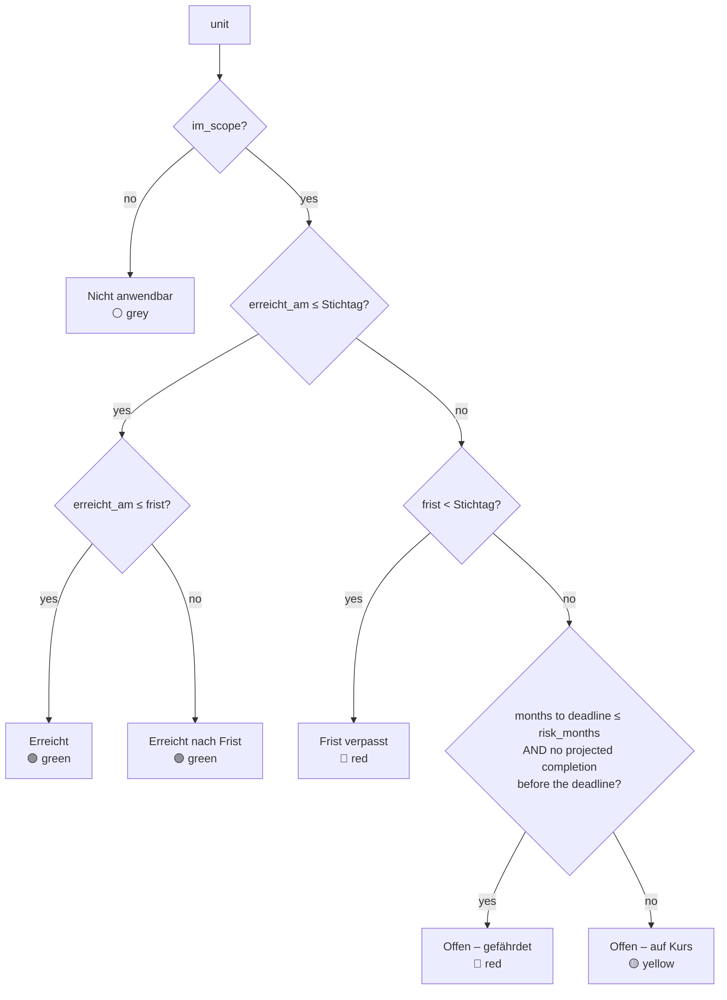

`risk_months` is 6 for goal 1 and 12 for goals 2 and 3. The projected completion date is what
keeps a person with a running full-time job from turning red: the job will complete the goal
in time, so the case stays yellow.

`finish()` packs everything into a `GoalResult`: the unit table, summaries by social worker
and by entry year, totals, issues, and the display column names. `restrict()` returns the
same structure for a subset, e.g. one social worker's cases, with the summaries recomputed.

## 9. Goal evaluation

All three evaluators share one signature:
`evaluate_goalN(tables, rules, stichtag, persons=None) -> GoalResult`. They raise
`ValueError` when a required export is missing; the UI shows that message and keeps the other
goals.

### 9.1 Goal 1: language A1

| | |
|---|---|
| Unit | person |
| Requires | `klient`, `asylgeschaeftsdaten`, `sprachstand` |
| Deadline | entry date + `goal1.deadline_years` (3) |
| In scope | VA/FL status, aged 16 or more at the deadline |

A `Sprachstand` row qualifies when its level is at least `min_level` (`A1`, ranked
A0 < A1 < … < C2), its language is in `languages` (German, French) and its proof type is in
`accepted_proofs`. The **earliest dated** qualifying row counts. A qualifying row without a date
is reported and does not count.

`Integrationszielerreichung` rows matching `reached_goal_pattern` give a second source:
the goal as *recorded for payment*. `erreicht_am` is the earlier of the two.

Two reconciliation checks come out of comparing the two sources:

- *recorded but no language proof* → `Info`;
- **A1 proven on time but never recorded as reached** → `Info` "Abgeltung prüfen" (check the
  payment). This is the "money found" finding: each case is a payment the service may be owed.

### 9.2 Goal 2: work or training

| | |
|---|---|
| Unit | person |
| Requires | `klient` and at least one of `erwerb` / `integrationsfoerderung` |
| Deadline | effective responsibility end |
| Reached | `min_months` (6) without interruption at ≥ `min_pensum` (60 %), **or** education of a type in `education_types` (Sek II, tertiary), counted from `start` or `abschluss` (completion) |

Jobs are prepared before the time-line computation:

- open-ended jobs end on the Stichtag; jobs without a pensum are reported and dropped;
- `erwerbsstatus` is filtered by `erwerbsstatus_counts`;
- employers matching `exclude_employer_pattern` are dropped. The export has no flag for the
  primary labour market, so employment programmes are recognised by name.

`qualifying_runs()` finds the periods during which the total pensum is high enough. With
`sum_parallel_jobs: true` it is a **sweep line** over pensum changes: +pensum on the start day,
−pensum on the day after the end. This way two parallel 30 % jobs count as 60 %:

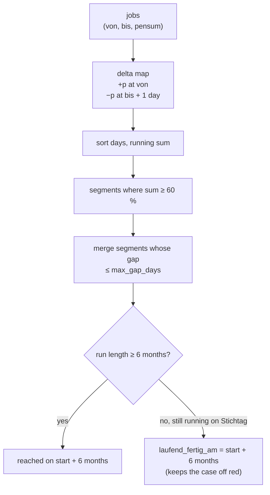

A running qualifying job also produces a hint ("goal met on dd.mm.yyyy"), which the call list
shows.

**ZEMIS cross-check.** `_zemis_check()` compares the work notifications the federal ZEMIS system
holds with the `Erwerb` export, using a ±31-day tolerance. Work known to ZEMIS but missing from
`Erwerb` is flagged as a `Warnung` and as a hint on the person: it may be unrecorded work that
already satisfies the goal.

### 9.3 Goal 3: no social assistance

| | |
|---|---|
| Unit | **household** (Dossier-Nr.) |
| Requires | `klient`, `finanzielle_unterstuetzung` |
| Deadline | responsibility end of the household head (`household_deadline: dossiertraeger`); alternatively the latest or earliest across all members |
| Reached | 12 months in a row (`min_months`) without support of a type in `assistance_types` (Sozialhilfe, Nothilfe) |

`household_heads()` takes the active `Dossierträger/-in` from `Dossierperson`. If there is none,
it falls back to the oldest member. The household row inherits the head's status and scope.

`free_spells()` computes the gaps between assistance periods, from the first recorded entry up
to the Stichtag:

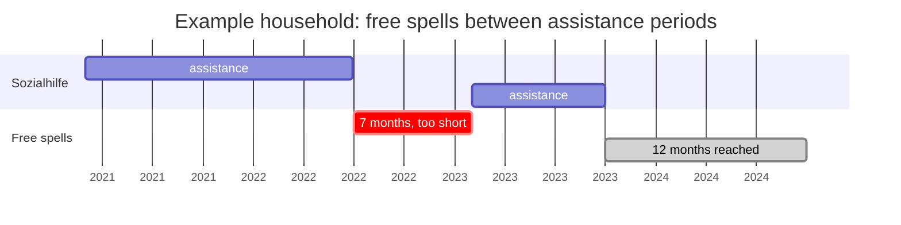

A household that has no entries in `Finanzielle Unterstützung` is excluded with an explicit
reason rather than being counted as "never on assistance".

## 10. Cockpit matrix and call list

`cockpit_matrix(r1, r2, r3)` starts from the goal-1 persons and left-joins each goal's status,
traffic light, deadline, months remaining, scope and hint. The columns are prefixed `z1_`,
`z2_`, `z3_`. Goal 3 is joined on the dossier and counts only for the household head, so a
household is not counted once per member. People in scope for no goal are dropped.

- **Priority** (`prioritaet`) is the worst traffic light among the person's *open* goals, i.e.
  `Offen – gefährdet` or `Offen – auf Kurs`.
- **Next open deadline** is the earliest deadline among those open goals.
- The rows are sorted by priority (red → yellow → green → grey), then by the next open
  deadline.

`call_list(matrix, limit=15)` turns the first prioritised rows into cards. Each card lists every
open goal with a plain-language reason, the deadline, the months remaining and any hint, the
red goals first.

In the social-worker role, `app.py` restricts the matrix and every `GoalResult` to
`fallfuehrung == <selected worker>` before rendering.

## 11. Level 2: pattern analysis

`level2.analyse(result, tables, rules, extra)` answers: *what do people who reached the goal on
time have in common?*

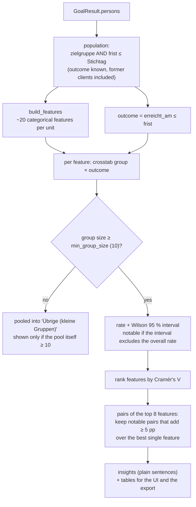

**Features**, all binned or categorical:

- age at entry, sex, nationality, mother tongue;
- school years, Latin-script literacy, highest education, work experience, entry year;
- role in the household and household size (from `Dossierperson`); small child under 4 in the
  household at entry;
- first German course after entry, course intensity, literacy course attended (from
  `Integrationsförderung`);
- housing 12 months after entry (`Unterbringung`);
- the five Situationsanalyse features, when the reviewed feature file was uploaded;
- for goals 2 and 3, "Goal 1 (A1) reached" is added via `extra`;
- the case worker is a feature **only** when `level2.include_case_worker` is `true`; it is off by
  default because it amounts to evaluating employees.

**Statistics**:

- Wilson score interval: `centre ± z·√(p(1−p)/n + z²/4n²) / (1 + z²/n)`, with z = 1.96.
- Cramér's V: computed from the χ² of the crosstab of group × outcome. Because the outcome is
  binary, it reduces to √(χ²/n).
- Groups labelled `unbekannt`, `unklar` or `keine Situationsanalyse` are excluded from
  combinations and insights.

**Privacy guarantees** (each one pinned by a test):

- no value is ever returned per person;
- no group under `min_group_size` is shown;
- the small groups are pooled into one bucket only when the pool itself reaches the minimum;
- a population under the minimum yields a single message and no tables.

The UI and the export always attach a caveat: associations are descriptive, not causal.
Courses are allocated to people with higher needs, so a lower success rate among course
participants does not mean the course harms.

## 12. Situationsanalyse: free text to features

The Situationsanalyse is a Word form with one section per household member. The extraction
turns it into five features per person.

| Feature | Values |
|---|---|
| `psychische_belastung` (psychological burden) | ja / nein / unklar |
| `lernmotivation` (motivation to learn) | hoch / mittel / tief / unklar |
| `lerntempo` (learning speed) | schnell / mittel / langsam / unklar |
| `betreuung_hindernis` (care duties as an obstacle) | ja / nein / unklar |
| `soziales_netz` (social network) | gut / schwach / unklar |

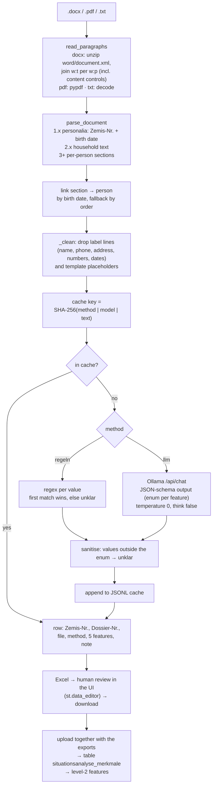

- **Personal data is removed before any extraction.** Lines that start with labels such as
  name, first name, phone, e-mail, street, postcode, N or Zemis number, social worker, birth
  date or entry date are dropped. The model never sees them; only the household text and the
  person's own sections reach it.
- **Constrained LLM output.** Ollama's `format` parameter receives a JSON schema with an `enum`
  per feature. The response is still validated, and anything outside the enum becomes `unklar`.
- **Resumable batch runs.** The CLI (`python -m cockpit.situationsanalyse <folder> --methode llm
  --cache file.jsonl --workers N`) appends every result to a JSONL cache, so an interrupted run
  continues where it stopped. A thread pool with a lock protects the cache and the progress
  counter.
- **A human stays in the loop.** The result is an Excel file that a professional checks and
  corrects in the editable grid before uploading it.
- **Measured quality.** On synthetic data, `evaluate()` compares the extraction with
  `data/situationsanalyse_ground_truth.csv` and reports the hit rate per feature. The UI shows
  it for each available method. The rules are tuned to the phrasing of the synthetic reports;
  on real reports the LLM is expected to be more robust, and this must be measured with real,
  anonymised reports.

On CPU the LLM needs about 20 seconds per person.

## 13. Excel export

`export.build_workbook(results, rules, issues, sources, level2, matrix)` returns the bytes of an
`.xlsx` file with these sheets:

| Sheet | Content |
|---|---|
| Übersicht | Stichtag, totals per goal, the source file of each table |
| Cockpit (alle Ziele) | The matrix: one row per person, status and deadline per goal |
| Ziel N – Personen / Haushalte | Unit table sorted red → green, then by deadline |
| Ziel N – Fallführung | Summary per social worker |
| Ziel N – Einreisejahr | Summary per entry year |
| Datenqualität | All issues |
| Annahmen | `rules.yaml` flattened into key/value rows |
| Muster ZN – … | Insights with the caveat, feature ranking, groups, combinations (selected goal, management role only) |

The styling: a dark-blue bold header, frozen first row, auto-filter, column widths fitted to the
content (10 to 60 characters), `DD.MM.YYYY` dates, `0.0%` rates, and rows or cells coloured by
traffic light. Sheet names are cut to Excel's limit of 31 characters.

The download button receives a **callable**, so the workbook is only built when it is clicked.

## 14. The Streamlit application

### 14.1 Request cycle and caching

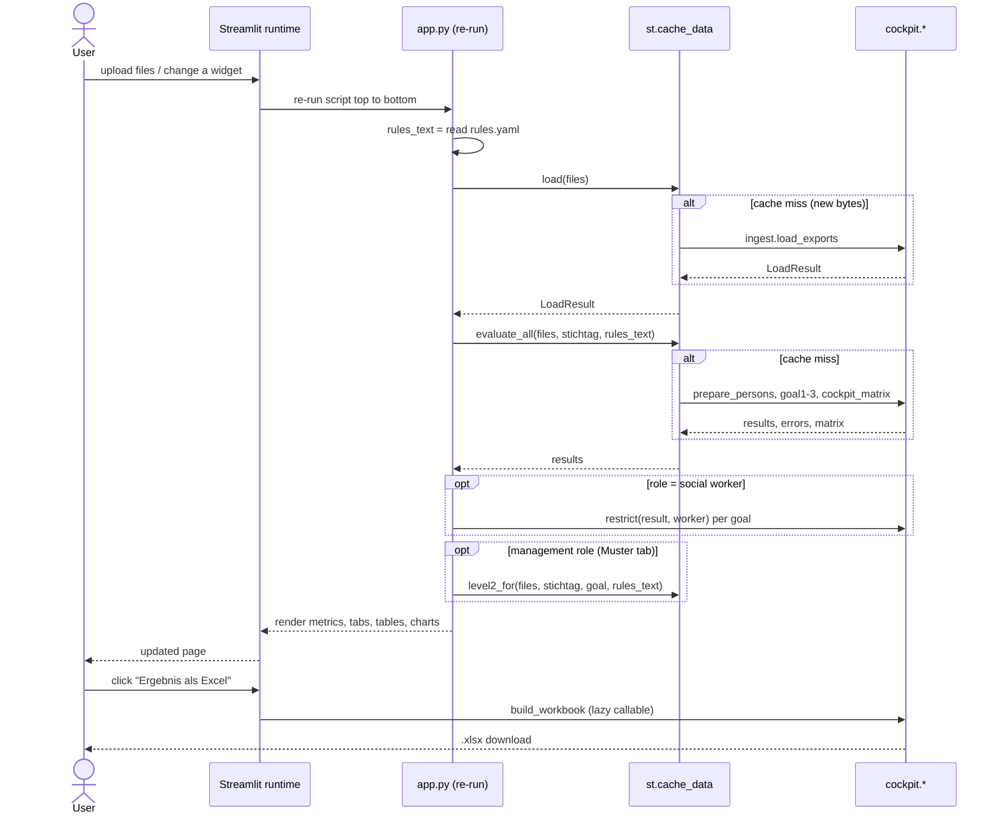

The cache keys are the tuple of `(file name, file bytes)`, the Stichtag and the text of
`rules.yaml`, so changing the date, the files or a rule invalidates exactly what depends on
them. Switching role, goal or tab does not re-compute any goal.

### 14.2 Screen structure

| Area | Content |
|---|---|
| Sidebar · Daten | Source: synthetic demo data or own uploads; choice of Situationsanalyse feature file (rules / local LLM); Stichtag |
| Sidebar · Ziel / Ansicht | Goal 1–3; role *Leitung* (management) or *Sozialarbeiter:in* (social worker), plus the worker picker; result download |
| Header | Six metrics: in scope, reached, on track, at risk, missed, on-time rate |
| Tabs (management) | Cockpit · Übersicht · Muster · Situationsanalysen · Liste · Datenqualität · Annahmen |
| Tabs (social worker) | Wen rufe ich an? · Cockpit · Übersicht · Liste · Datenqualität · Annahmen |

`.streamlit/config.toml` binds the server to `localhost`, runs headless, disables usage
statistics (`gatherUsageStats = false`), allows uploads up to 200 MB and sets the light theme
with the primary colour `#1F4E78`.

## 15. Rules and configuration

Every business rule that the challenge leaves open lives in [`rules.yaml`](../../rules.yaml),
with a comment explaining it. The main keys:

| Key | Default | Meaning |
|---|---|---|
| `current_clients.require_responsibility_active` | `true` | Current client = responsibility end empty or ≥ Stichtag |
| `current_clients.exclude_after_handover` | `true` | Handed over to the municipality = no longer a client |
| `status.strip_suffix_pattern` | `\+\d+$` | `B-FL+5` → `B-FL` |
| `status.eligible` | VA, F-FL, B-FL, B-RSFL, B-SL | Statuses the goals apply to |
| `entry.event` / `fallback_events` / `pick` | Aufenthalt (Einreise) / Aufenthalt (Geburt) / earliest | Entry date |
| `responsibility.*` | 5 years from application / 7 from entry; 5 from entry after 2027-01-01 | Computed responsibility end when the export has none |
| `goal1.deadline_years`, `min_age`, `age_reference` | 3, 16, deadline | |
| `goal1.accepted_proofs` | telc, fide, mother tongue, … | Empty list = every proof type counts |
| `goal2.min_pensum`, `min_months`, `sum_parallel_jobs`, `max_gap_days` | 60, 6, true, 0 | |
| `goal2.exclude_employer_pattern` | Beschäftigungsprogramm, … | Secondary labour market |
| `goal2.education_types`, `education_counts_from` | Sek II, Tertiär · start | |
| `goal3.assistance_types`, `household_deadline` | Sozialhilfe, Nothilfe · dossiertraeger | |
| `goalN.reached_goal_pattern` | regex | Matches `Integrationszielerreichung.ziel` |
| `goalN.risk_months` | 6 / 12 / 12 | Window for "at risk" |
| `level2.min_group_size` | 10 | Smallest group ever shown |
| `level2.include_case_worker` | `false` | Only with the employees' consent |

The *Annahmen* (assumptions) tab shows the file, and the export contains it.

`app.py` reads the text of `rules.yaml` on every run and passes it to the cached functions
`evaluate_all()` and `level2_for()` as an argument. The text is therefore part of the cache key:
an edited rules file takes effect at the next interaction, and an unchanged one costs no
recomputation. `cockpit/rules.py` offers `read_rules_text()`, `rules_from_text()` and
`load_rules()` (the two combined, used by the tests).

## 16. Synthetic data generator

`python -m synth.generate --out data/synthetic --households 220 --seed 42` writes the eleven
exports, one Situationsanalyse `.docx` per household into `data/situationsanalysen/`, and the
ground truth into `data/situationsanalyse_ground_truth.csv`. No real people are involved.

- **Deterministic:** seeded `random.Random`. A second generator (`seed + 7`) is used for
  additions, so extending the generator does not change the existing data.
- **Realistic structure:** status mix, eight nationalities with languages, script and
  schooling ranges, households with partners and children, children born in Switzerland,
  housing moves, courses, jobs, social-assistance spells. Headers come from
  `schema.export_headers()`, and three tables write their dates as text, as the real exports do.
- **A planted pattern**, so level 2 has something real to find. The chance of reaching A1 is a
  logistic function of school years, Latin-script literacy, age, the case worker's skill and
  the hidden Situationsanalyse traits (burden, motivation, care duties, social network).
  `tests/test_level2.py` asserts that the analysis finds it.
- **Deliberate data errors**, so data quality has something to report: an invalid date
  (`31.02.2023`), A1 certificates without a date, a language record for a client who does not
  exist.

## 17. Tests

```powershell
.venv\Scripts\python.exe -m pytest -q
```

Run the tests from the project root with `python -m pytest`; `-m` puts the root on `sys.path`.
There are 35 test functions; with parametrisation they run as 54 test cases:

| File | Tests | Covers |
|---|---|---|
| `test_ingest.py` | 6 | Table detection, prefix headers, Swiss and invalid dates, unknown files, the organisers' templates are recognised |
| `test_goal1.py` | 8 | Status categories, scope reasons, age at the deadline, proof rules, earliest proof vs. recorded goal, birth-in-Switzerland fallback, missing table, level ranking |
| `test_goal2_3.py` | 8 | Parallel jobs and gaps, programmes excluded, a running job keeps the case on track, the ZEMIS cross-check, computed responsibility end, free spells, households, goal 3 only for the head in the call list |
| `test_level2.py` | 7 | Wilson interval, population limited to known outcomes, **small groups never shown, no person-level output**, planted pattern found, too-small population, pooling |
| `test_situationsanalyse.py` | 6 | Section ↔ Zemis linking, **personal data removed before extraction**, rules vs. ground truth, LLM output sanitised, plain text and cache |

Most tests build their data with the synthetic generator inside fixtures. The one exception is
`test_received_templates_are_recognized`, which reads the organisers' templates from `doc/`.

## 18. Privacy and security design

| Threat | Measure |
|---|---|
| Data at rest | Nothing is written by the app: uploads live in memory and in Streamlit's in-process cache |
| Data leaving the network | Server bound to `localhost`; usage statistics off; the LLM is local (Ollama on `localhost:11434`); no external API calls |
| Personal data in free text | Identifying lines are stripped before extraction; only five categorical labels come out |
| Profiling individuals | Level 2 outputs groups ≥ 10 only; never a per-person value; case worker off by default |
| Wrong conclusions | Caveat on every pattern view; computed deadlines are marked `berechnet` |
| Data-quality errors silently skewing results | Every dropped row, unparseable date and unmatched key becomes a visible issue |

**Not covered by the prototype:** there is no authentication and no role enforcement. The role
switch is a view filter, not an access control. It must run on a trusted machine, or behind an
authenticating reverse proxy if it is ever exposed beyond `localhost`.

## 19. Demo video pipeline

`tools/demo-video/` generates the pitch video reproducibly. It is not needed to run the app.

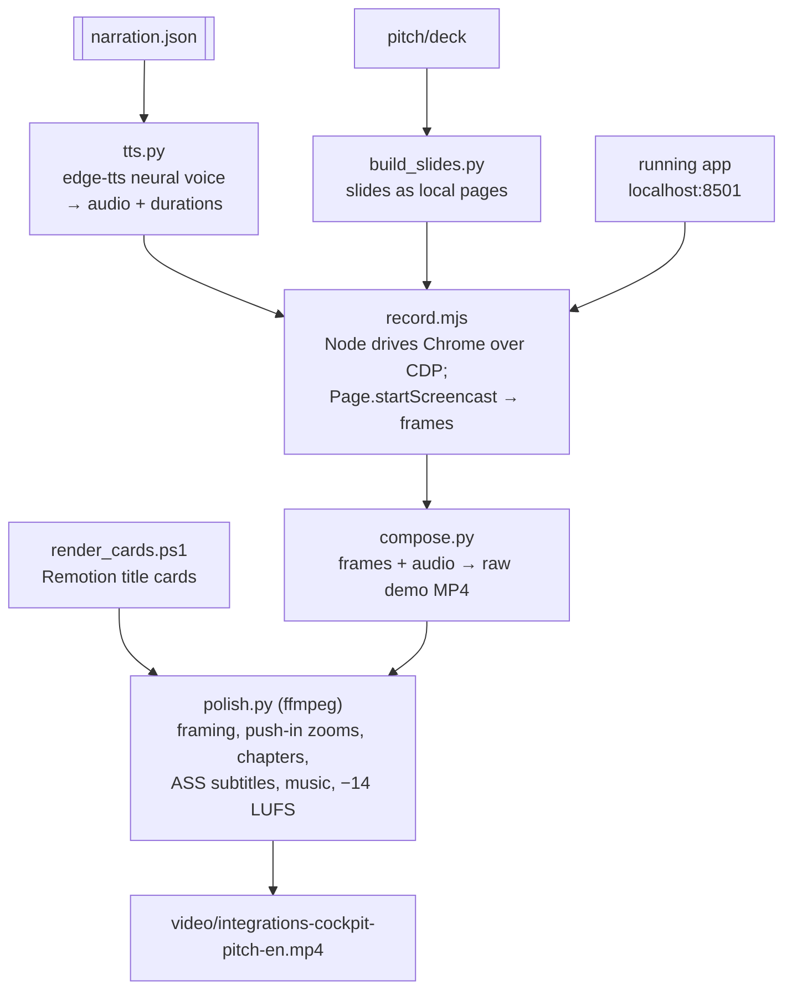

The music file is not in the repository (Pixabay licence); `assets/music/CREDITS.txt` names it.

## 20. Extending the application

| Task | Where |
|---|---|
| A real export uses a different header | Add the spelling to the field's alias list in `cockpit/schema.py`. The first alias is the one the generator writes. |
| A business rule is clarified | Change the value in `rules.yaml`; no code change. |
| A new rule parameter | Add it to `rules.yaml` with a comment and read it with `.get(key, default)` in the goal module, so older rule files keep working. |
| A new export table | Add a `TABLES` entry with `columns`, a unique `signature` and `dates`; then use it via `tables.get(name)`. |
| A fourth goal | New `goalN.py` returning a `GoalResult` built with `apply_scope`, `classify` and `finish`; register it in `GOALS` in `app.py` and join it in `cockpit_matrix`. |
| A new level-2 feature | Add a column in `level2.build_features`. Grouping, intervals and the privacy filters apply automatically. |
| A new Situationsanalyse feature | Add it to `FEATURES` with values, definition and rules; the LLM schema and prompt are derived from it. Add its column to `schema.TABLES["situationsanalyse_merkmale"]`. |

## 21. Known limitations

- Five export layouts are derived from the data model, not from real templates, and must be
  checked against real exports.
- The keyword rules are tuned to the synthetic phrasing; their accuracy on real reports is
  unknown.
- Level 2 is descriptive. Selection effects (who gets which course) are not modelled.
- Single user per process, everything in memory. Very large exports are bounded by RAM and by
  the 200 MB upload limit.
- No authentication; the role switch is not a security boundary.
- The user interface is in German only.
