# Integrations-Cockpit: user manual

*For social workers and management at the Asylsozialdienst.*
*Language versions: English (this file) · [Română](../ro/manual-utilizare.md)*

Related: [Installation and configuration](installation.md) · [Technical documentation](technical-documentation.md)

> The screenshots show the **synthetic demo data**. None of the people in them are real. The
> application's interface is in German; this manual gives each label in German, followed by
> its meaning.

---

## Contents

1. [What the cockpit does for you](#1-what-the-cockpit-does-for-you)
2. [The three goals and the traffic light](#2-the-three-goals-and-the-traffic-light)
3. [Opening the application](#3-opening-the-application)
4. [The screen at a glance](#4-the-screen-at-a-glance)
5. [Loading data](#5-loading-data)
6. [Choosing goal and role](#6-choosing-goal-and-role)
7. [For social workers: "Wen rufe ich an?"](#7-for-social-workers-wen-rufe-ich-an)
8. [Cockpit: all goals per person](#8-cockpit-all-goals-per-person)
9. [Übersicht: by entry year and by social worker](#9-übersicht-by-entry-year-and-by-social-worker)
10. [Liste: the detailed list per goal](#10-liste-the-detailed-list-per-goal)
11. [Datenqualität: what to correct, and money to claim](#11-datenqualität-what-to-correct-and-money-to-claim)
12. [Muster: what successful people have in common](#12-muster-what-successful-people-have-in-common)
13. [Situationsanalysen: free-text reports into features](#13-situationsanalysen-free-text-reports-into-features)
14. [Annahmen: the rules in force](#14-annahmen-the-rules-in-force)
15. [Taking the result to Excel](#15-taking-the-result-to-excel)
16. [A typical month](#16-a-typical-month)
17. [Glossary](#17-glossary)
18. [Frequently asked questions](#18-frequently-asked-questions)

---

## 1. What the cockpit does for you

The cockpit reads the Excel exports you already get from the case-management system and
answers three questions:

- **Who is on track, and who is at risk?** For each client and each integration goal it shows
  a deadline and a traffic light.
- **Whom should I call this week?** Each social worker gets a list of their own cases, the
  most urgent first, with the reason written out.
- **What is missing or wrong in the data?** It lists, for example, goals that were reached
  but never recorded. Each of those is a payment to check.

Management also sees **patterns**: what the people who reached a goal on time have in common.

The application **stores nothing**. You upload the files, look at the result, download it as
Excel if you wish, and close the browser. No data leaves the computer.

## 2. The three goals and the traffic light

| Goal | Label in the app | Reached when | Deadline | Applies to |
|---|---|---|---|---|
| 1 | Ziel 1 · Sprache A1 | Language level A1 in German or French, proven by a recognised proof | 3 years after entry | Provisionally admitted (VA), refugees and stateless persons, aged 16 or more |
| 2 | Ziel 2 · Arbeit / Ausbildung | 6 months in a row of work at 60 % or more (parallel jobs add up), or training at upper-secondary (Sek II) or tertiary level | End of the service's responsibility | Same as goal 1 |
| 3 | Ziel 3 · Ohne Sozialhilfe | The whole **household** 12 months in a row without social assistance | End of the service's responsibility | The household (dossier) |

Each goal gets one of these statuses:

| Light | Status in the app | Meaning |
|---|---|---|
| 🟢 | **Erreicht** | Reached before the deadline |
| 🟢 | **Erreicht nach Frist** | Reached, but after the deadline |
| 🟡 | **Offen – auf Kurs** | Not yet reached, enough time left, or a running job will complete it in time |
| 🔴 | **Offen – gefährdet** | Not yet reached and the deadline is close: within 6 months for goal 1, within 12 months for goals 2 and 3 |
| 🔴 | **Frist verpasst** | The deadline has passed without the goal being reached |
| ⚪ | **Nicht anwendbar** | The goal does not apply to this person; the reason is shown in the list |

Everything is calculated for the **Stichtag** (reference date), which is today unless you
change it.

## 3. Opening the application

The application runs on a computer of the service. Whoever installed it gives you the address,
usually **http://localhost:8501**. Open it in Chrome, Edge or Firefox. The first load takes
about 20 seconds.

## 4. The screen at a glance

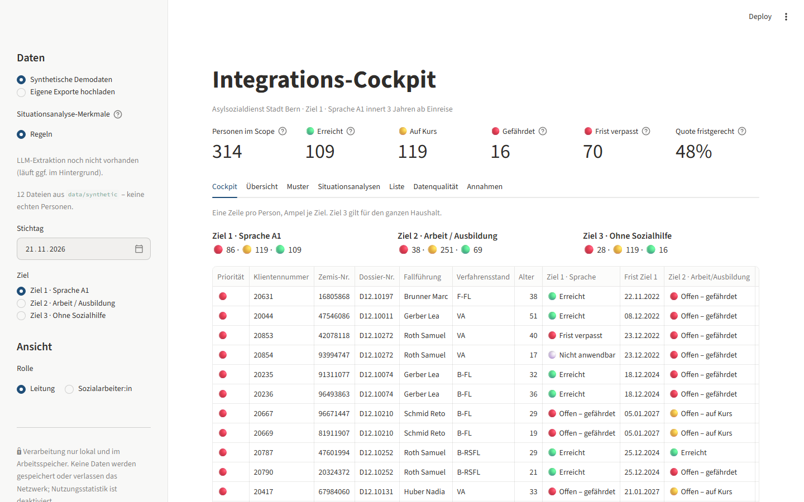

| Area | What is there |
|---|---|
| **Left sidebar** | Where the data comes from, the Stichtag, the goal, your role, and the Excel download |
| **Header** | Six key figures for the selected goal |
| **Tabs** | The different views; which ones you see depends on your role |

The six key figures for the selected goal:

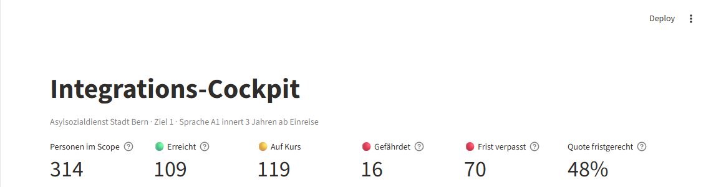

| Figure | Meaning |
|---|---|
| Personen im Scope (or Haushalte im Scope) | Current cases to which the goal applies |
| 🟢 Erreicht | Reached; hover the **?** to see how many were late |
| 🟡 Auf Kurs | Open, on track |
| 🔴 Gefährdet | Open, at risk |
| 🔴 Frist verpasst | Deadline missed |
| Quote fristgerecht | Goal 1: share reached on time among the cases that are due. Goals 2 and 3: share reached on time among closed cases, former clients included. |

Hover any **?** symbol for an explanation.

## 5. Loading data

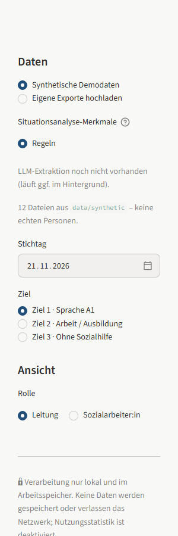

The sidebar starts with **Daten** (data). It offers two sources:

- **Synthetische Demodaten** (synthetic demo data): an invented population to try the
  application out. The caption confirms that no real people are involved.
- **Eigene Exporte hochladen** (upload own exports): your real exports.

### 5.1 Uploading real exports

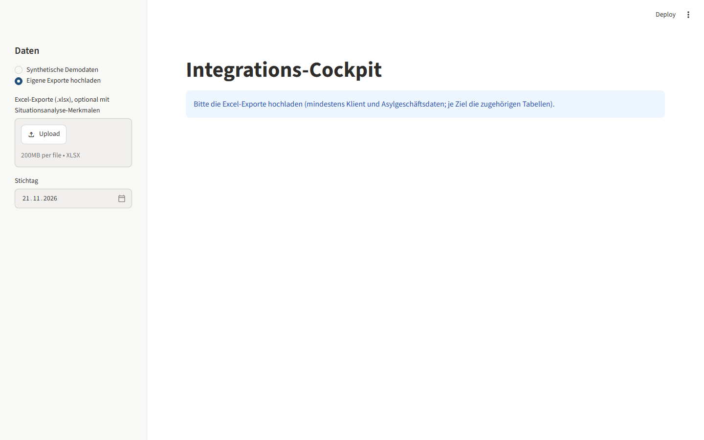

1. Choose **Eigene Exporte hochladen**.
2. Click **Upload**, or drag the files onto the field. Select **all files at once**; the names
   do not matter, because the application recognises each table by its columns.
3. The results appear as soon as the files are read.

What you need for each goal:

| For | Exports |
|---|---|
| everything | Klient |
| Goal 1 | Asylgeschäftsdaten, Sprachstand |
| Goal 2 | Erwerb and/or Integrationsförderung und Ausbildung |
| Goal 3 | Finanzielle Unterstützung |
| More detail, patterns, checks | Dossierperson, Unterbringung, Integrationszielerreichung, ZEMIS Tätigkeit, Asylverfahrensstand |

If a goal's exports are missing, that goal disappears from the selection and the sidebar
names the missing exports. The other goals keep working.

You can also upload a reviewed **Situationsanalyse_Merkmale.xlsx** together with the exports;
see [section 13](#13-situationsanalysen-free-text-reports-into-features).

### 5.2 Stichtag

**Stichtag** (reference date) is the date the evaluation is made for, today by default. Choose
an earlier date to see how things stood then, or the end of a month for a monthly report.

## 6. Choosing goal and role

Further down in the sidebar:

- **Ziel** (goal): choose goal 1, 2 or 3. The key figures, *Übersicht*, *Liste* and *Muster*
  follow this choice. The *Cockpit* tab always shows all three goals.
- **Ansicht → Rolle** (view → role):
  - **Leitung** (management): all cases, plus the *Muster* and *Situationsanalysen* tabs.
  - **Sozialarbeiter:in** (social worker): pick your name under **Fallführung** (case
    worker). Every figure and table then shows only your cases, and the
    **Wen rufe ich an?** tab appears.

> The role is a view, not a permission. Everyone at the computer can switch it.

## 7. For social workers: "Wen rufe ich an?"

"Wen rufe ich an?" means "whom do I call?". It is the first tab in the social-worker role.

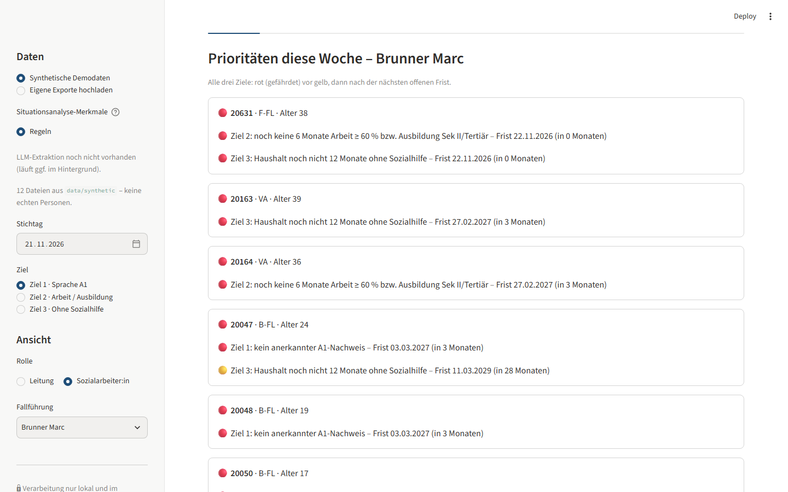

The list shows up to 15 of your clients who have at least one **open** goal, sorted:

1. red (at risk) before yellow (on track);
2. within the same colour, the nearest deadline first.

Each card shows the client number, status and age, and below them one line per open goal:
what is missing, the deadline, and how many months are left. Some lines carry a hint, for
example:

- "Laufende Anstellung ≥ 60 % seit … – Ziel am … erfüllt": a running job of 60 % or more since
  that date will complete the goal on the date shown.
- "ZEMIS meldet Arbeit ab … – nicht in Erwerb": the federal register reports work that is
  missing from the *Erwerb* export. Record it, and the goal may already be reached.

**Suggested routine:** open the list on Monday, work from the top, and record what you learn
in the case-management system. The next export shows the effect.

## 8. Cockpit: all goals per person

The **Cockpit** tab is one row per person, with the status and deadline of all three goals side
by side (see the screenshot in [section 4](#4-the-screen-at-a-glance)).

- Above the table, each goal has a count of 🔴 red, 🟡 yellow and 🟢 green.
- **Priorität** (priority) is the worst light among the person's open goals.
- The rows are sorted by priority, then by **Nächste offene Frist** (next open deadline).
- Goal 3 belongs to the household. It is shown on the row of the household head, so a family
  is not counted several times.

Table tips:

- Click a column header to sort by it.
- Hover the table and use the icons at its top right to search, enlarge to full screen, or
  download the table as CSV.
- Drag the edge of a column to widen it.

Goal 3 selected, management view:

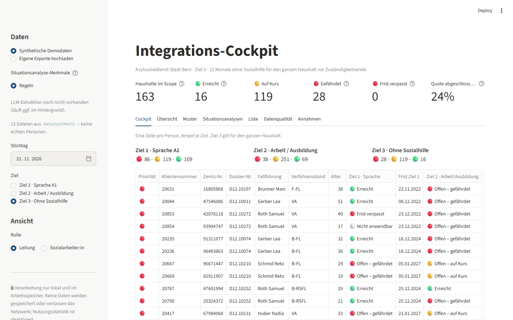

## 9. Übersicht: by entry year and by social worker

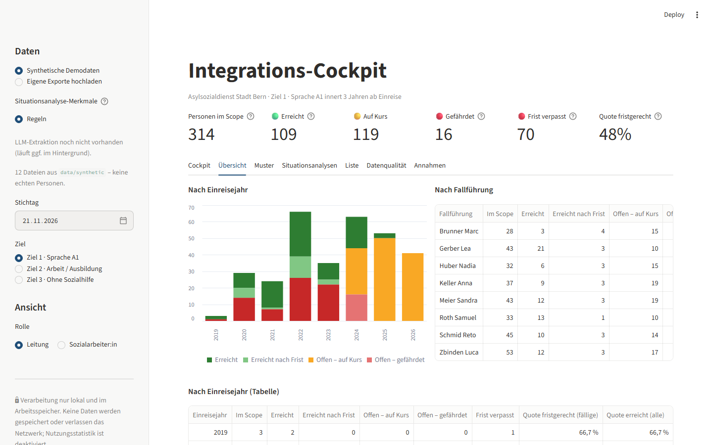

**Übersicht** (overview) shows the selected goal as:

- **Nach Einreisejahr** (by entry year): a bar chart of the statuses per year of entry, and the
  same numbers as a table further down;
- **Nach Fallführung** (by case worker): one row per social worker, with counts per status and
  two rates. In the social-worker role this becomes **Meine Fälle** (my cases).

The two rates:

- **Quote fristgerecht (fällige)**: reached on time, divided by all cases that are due, i.e.
  reached or with the deadline passed;
- **Quote erreicht (alle)**: reached at all, on time or late, divided by all cases in scope.

## 10. Liste: the detailed list per goal

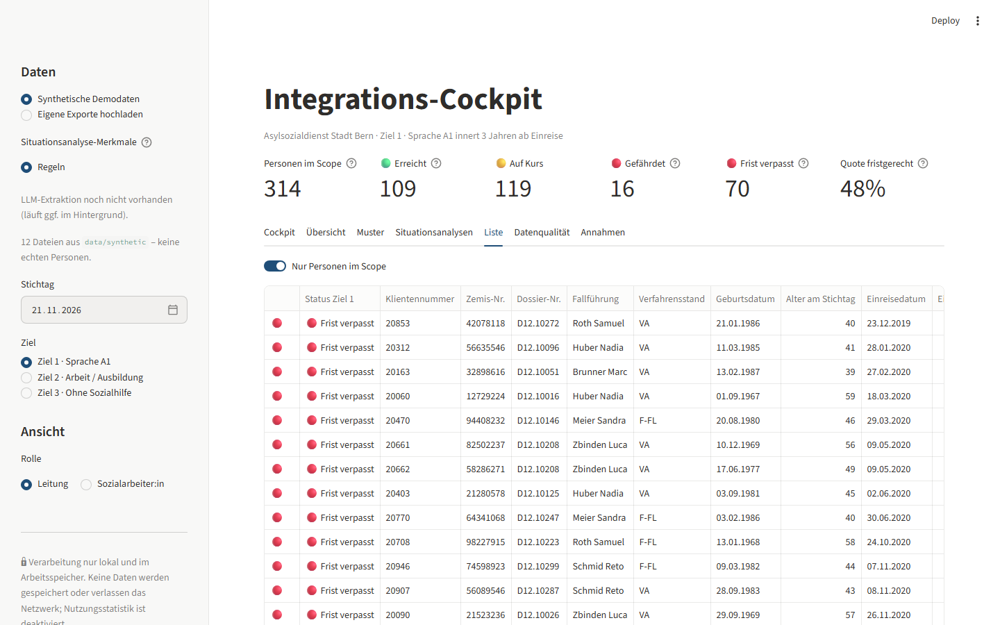

**Liste** (list) shows one row per person, or per household for goal 3, with every detail for
the selected goal: dates, deadline, months left, when and how it was reached, the source of the
data, and hints. The red cases come first.

Switch off **Nur Personen im Scope** (only persons in scope) to also see the people to whom the
goal does not apply. The column **Grund nicht anwendbar** (reason not applicable) then says
why: too young, a status that is not part of the goals, responsibility ended, entry date
missing, and so on.

## 11. Datenqualität: what to correct, and money to claim

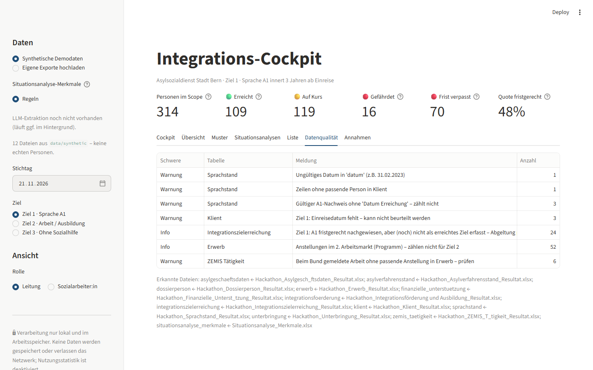

**Datenqualität** (data quality) lists everything the application noticed while reading and
evaluating the data, with a count for each:

| Severity | Meaning |
|---|---|
| **Fehler** (error) | A file could not be read, or client numbers occur twice; results can be wrong |
| **Warnung** (warning) | Data that could not be used: an invalid date, a missing entry date, a row without a matching client |
| **Info** | Worth knowing, or worth money |

Messages to act on first:

- **"A1 fristgerecht nachgewiesen, aber (noch) nicht als erreichtes Ziel erfasst – Abgeltung
  prüfen"**: A1 was proven on time but never recorded as a reached goal. Each case is a payment
  the service may be owed. Record the goal.
- **"Beim Bund gemeldete Arbeit ohne passende Anstellung in Erwerb – prüfen"**: work the federal
  register knows about is missing from the *Erwerb* export.
- **"Gültiger A1-Nachweis ohne 'Datum Erreichung' – zählt nicht"**: a valid A1 proof has no
  date, so it cannot count. Add the date.
- **"Ungültiges Datum"**: an invalid date, such as 31.02.2023. Correct it in the source system.

Below the table, **Erkannte Dateien** (recognised files) shows which uploaded file was read as
which table. Check it whenever a figure looks wrong.

## 12. Muster: what successful people have in common

*Management role only.*

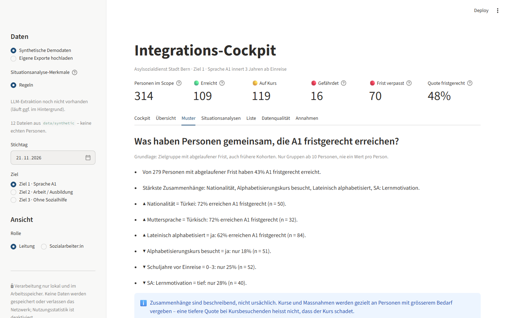

**Muster** (patterns) compares groups of people whose deadline for the selected goal has
already passed, former clients included, because only for them is the outcome known. It
answers: in which groups did more, or fewer, people reach the goal on time?

- The bullet points at the top summarise the findings. ▲ marks a group that does better than
  average, ▼ one that does worse.
- **Merkmale nach Stärke des Zusammenhangs** (features by strength of association) ranks the
  features. The longer the bar, the more the success rate differs between that feature's
  groups.
- **Merkmal im Detail** (feature in detail): choose a feature to see each group's rate.

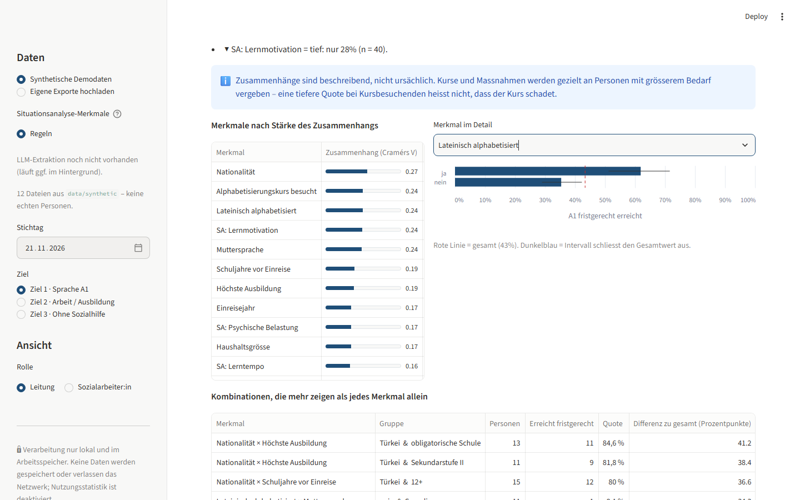

How to read the chart:

- each bar is a group, its length the share that reached the goal on time;
- the thin black line is the 95 % range in which the true value probably lies;
- the dashed red line is the average of everyone;
- a **dark blue** bar means the group really differs from the average, because its range does
  not include the average; a light bar may be chance.

**Kombinationen** (combinations) lists pairs of features that together say more than either
alone, e.g. a nationality combined with a level of schooling.

Rules you can rely on:

- **No group under 10 people** is ever shown. Smaller groups are pooled into
  "Übrige (kleine Gruppen)" (other, small groups), or left out.
- **No value for an individual person** appears anywhere on this tab.
- **An association is not a cause.** Courses go to people who need more support, so a lower
  rate among course participants does not mean the course does harm. Use the patterns to decide
  where to look more closely.

## 13. Situationsanalysen: free-text reports into features

*Management role only.*

The *Situationsanalyse* reports describe, in free text, things no export contains: psychological
burden, motivation to learn, learning speed, childcare duties, social network. This tab turns
them into five checkable features per person, which can then be used in *Muster*.

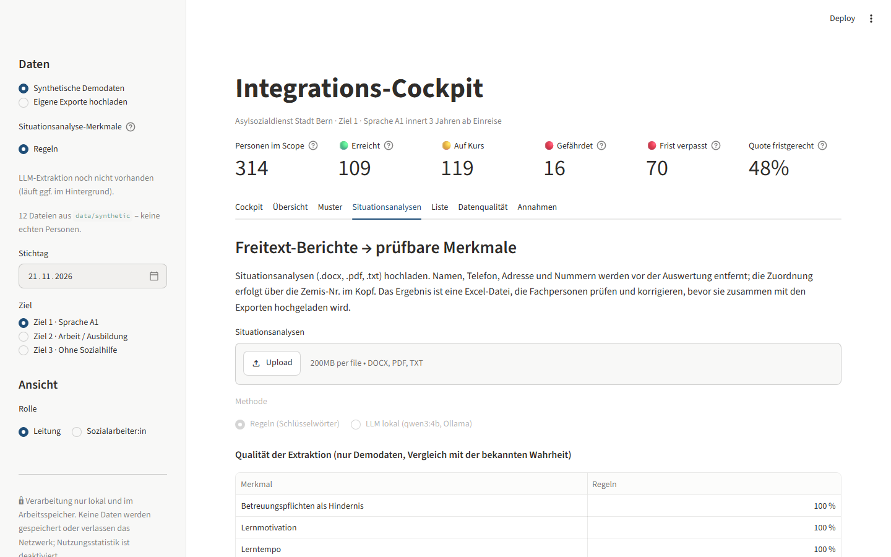

1. Upload the reports (`.docx`, `.pdf` or `.txt`) under **Situationsanalysen**. Names, phone
   numbers, addresses and ID numbers are removed before the analysis. Each person is matched by
   the Zemis number in the report's header.
2. Choose the **Methode** (method):
   - **Regeln (Schlüsselwörter)** (rules, keywords): fast; looks for known phrases.
   - **LLM lokal (qwen3:4b, Ollama)**: a language model running on this computer. It reads more
     flexibly and needs about 20 seconds per person. It is available only if Ollama is
     installed; otherwise the tab says "Lokales LLM nicht erreichbar".
3. Click **Merkmale extrahieren** (extract features). A progress bar counts the persons.

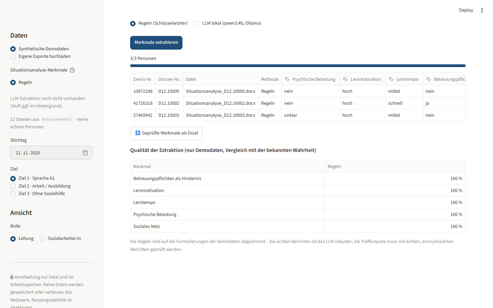

4. **Check the result.** The feature columns are editable: click a cell and pick another value
   if the report says something different. *unklar* means the report says nothing about it.
5. Click **Geprüfte Merkmale als Excel** (reviewed features as Excel) to download the file.
6. Next time, upload this file **together with the exports**. The *Muster* tab then also uses
   the five features, marked *SA:*.

With the demo data, the tab also shows **Qualität der Extraktion** (extraction quality): how
often each method matched the known truth. It exists only for the demo data, where the truth is
known.

## 14. Annahmen: the rules in force

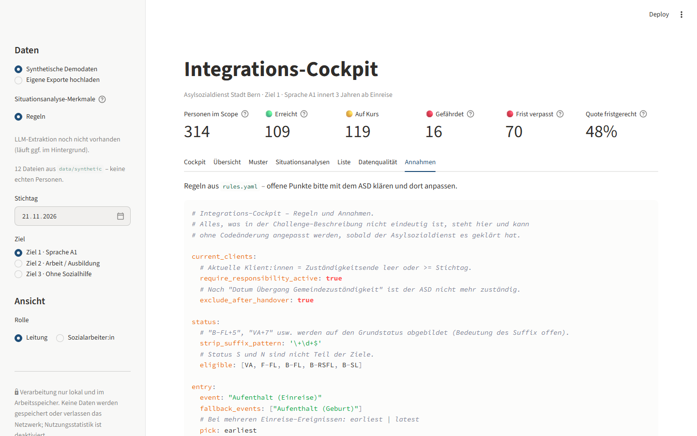

**Annahmen** (assumptions) shows the file `rules.yaml` with every rule the evaluation uses:
deadlines, minimum age, accepted language certificates, the 60 % threshold, which support counts
as social assistance, and so on. The comments explain each one. Points the challenge left open
are marked as assumptions.

To change a rule, ask whoever installed the application; see the
[installation manual](installation.md#61-business-rules-rulesyaml). The rules in force are also
written into every Excel result.

## 15. Taking the result to Excel

Click **⬇️ Ergebnis als Excel (alle Ziele)** (result as Excel, all goals) at the bottom of the
sidebar. The file name contains the Stichtag, and in the social-worker role also your name.

| Sheet | Content |
|---|---|
| Übersicht | Stichtag, key figures per goal, which file each table came from |
| Cockpit (alle Ziele) | One row per person, all three goals |
| Ziel 1/2/3 – Personen / Haushalte | The detailed list, red first, coloured by traffic light |
| Ziel 1/2/3 – Fallführung | Per social worker |
| Ziel 1/2/3 – Einreisejahr | Per entry year |
| Datenqualität | All messages |
| Annahmen | The rules in force |
| Muster Z… | The pattern results for the selected goal (management role) |

Each sheet has filters in its header row and a frozen first row. The rows are coloured green,
yellow, red or grey.

## 16. A typical month

| Who | When | What |
|---|---|---|
| Management | Start of the month | Export all tables, upload them, set the Stichtag to the end of the last month, download the Excel result for the record |
| Management | Same day | *Datenqualität*: assign the corrections and the "Abgeltung prüfen" cases |
| Social workers | Every Monday | Role *Sozialarbeiter:in*, own name, work through **Wen rufe ich an?** |
| Management | Quarterly | *Muster* for each goal: where do we lose people, which support seems to help? |

## 17. Glossary

| Term | Meaning |
|---|---|
| Stichtag | Reference date of the evaluation |
| Frist | Deadline for a goal |
| Zuständigkeitsende | The date the service's responsibility for a client ends; deadline for goals 2 and 3 |
| Fallführung | The social worker responsible for a case |
| Dossier / Haushalt | Household (*Unterstützungseinheit*); goal 3 is per household |
| Dossierträger/-in | Head of the dossier |
| Klientennummer / Zemis-Nr. | Internal client number / federal register number |
| VA, F-FL, B-FL, B-RSFL, B-SL | Statuses to which the goals apply: provisionally admitted and the categories of recognised refugees and stateless persons |
| Im Scope | A current case to which the goal applies |
| Zielgruppe | The goal applies to the person, current client or not |
| Abgeltung | The payment the service receives for a reached goal |
| Situationsanalyse | The social worker's free-text report on a household |
| SA: … | A feature taken from a Situationsanalyse |

## 18. Frequently asked questions

**A person I know reached A1 appears as red. Why?**
Open *Liste* and look at the row. The proof is usually missing a date, has a proof type that is
not accepted (see *Annahmen*), or is recorded under another client number. *Datenqualität*
lists such cases.

**Why does goal 3 show fewer cases than goals 1 and 2?**
Goal 3 counts households, not people.

**A person is grey, "Nicht anwendbar".**
The *Liste* tab, with *Nur Personen im Scope* switched off, shows the reason in
*Grund nicht anwendbar*.

**I changed a rule and the numbers did not move.**
The results are cached. Open the menu **⋮** at the top right and choose **Clear cache**, or
press `C`.

**Is the data saved anywhere?**
No. Closing the browser discards everything. Keep the Excel result if you need a record, and
store it like any other file containing personal data.

**Can I use it from home or on my phone?**
No. It runs only on the computer where it is installed.
