# Integrations-Cockpit: documentație tehnică

*Public țintă: dezvoltatori software care întrețin sau extind aplicația.*
*Versiuni: [English](../en/technical-documentation.md) · Română (acest fișier)*

Manuale asociate: [Instalare și configurare](instalare.md) · [Manual de utilizare](manual-utilizare.md)

Termenii de domeniu rămân în germană, așa cum apar în exporturi, în cod și în interfață
(*Stichtag*, *Fallführung*, *Zuständigkeitsende* etc.). La prima apariție sunt explicați.

---

## Cuprins

1. [Scop și perimetru](#1-scop-și-perimetru)
2. [Tehnologii utilizate](#2-tehnologii-utilizate)
3. [Arhitectura pe scurt](#3-arhitectura-pe-scurt)
4. [Modulele](#4-modulele)
5. [Modelul de date](#5-modelul-de-date)
6. [Fluxul de date de la un capăt la altul](#6-fluxul-de-date-de-la-un-capăt-la-altul)
7. [Ingest: de la fișiere Excel oarecare la tabele canonice](#7-ingest-de-la-fișiere-excel-oarecare-la-tabele-canonice)
8. [Baza de persoane](#8-baza-de-persoane)
9. [Evaluarea obiectivelor](#9-evaluarea-obiectivelor)
10. [Matricea cockpit și lista de apeluri](#10-matricea-cockpit-și-lista-de-apeluri)
11. [Nivelul 2: analiza tiparelor](#11-nivelul-2-analiza-tiparelor)
12. [Situationsanalyse: de la text liber la caracteristici](#12-situationsanalyse-de-la-text-liber-la-caracteristici)
13. [Exportul Excel](#13-exportul-excel)
14. [Aplicația Streamlit](#14-aplicația-streamlit)
15. [Reguli și configurare](#15-reguli-și-configurare)
16. [Generatorul de date sintetice](#16-generatorul-de-date-sintetice)
17. [Teste](#17-teste)
18. [Protecția datelor și securitate](#18-protecția-datelor-și-securitate)
19. [Pipeline-ul video demo](#19-pipeline-ul-video-demo)
20. [Extinderea aplicației](#20-extinderea-aplicației)
21. [Limitări cunoscute](#21-limitări-cunoscute)

---

## 1. Scop și perimetru

Asylsozialdienst (ASD, serviciul social pentru azil) al orașului Berna este plătit pentru
fiecare refugiat care atinge, până la un termen, unul din trei obiective de integrare. Sistemul
de gestiune a cazurilor poate produce unsprezece exporturi Excel, dar nimeni nu are o imagine
de ansamblu despre cine e pe drumul cel bun. Integrations-Cockpit:

- citește exporturile **așa cum sunt**: orice nume de fișier, antete în germană, date în format
  elvețian;
- evaluează fiecare dintre cele trei obiective per persoană (sau per gospodărie) la o dată de
  referință, **Stichtag**, și atribuie un semafor;
- combină cele trei obiective într-o matrice și într-o **listă de apeluri** prioritizată pentru
  fiecare asistent social;
- raportează **problemele de calitate a datelor**, inclusiv obiectivele atinse dar neînregistrate
  (venituri pierdute);
- descrie **tipare** (nivelul 2) printre persoanele care au atins un obiectiv la timp, doar la
  nivel de grup;
- transformă rapoartele în text liber *Situationsanalyse* (analiza situației) în caracteristici
  structurate, cu reguli pe cuvinte cheie sau cu un LLM **local**;
- scrie totul înapoi într-un singur registru Excel formatat.

Este un prototip construit la un hackathon. Codul e mic: aproximativ 2.100 de linii Python în
`app.py`, `cockpit/` și `synth/`. Nu are bază de date, nu ține stare pe server și nu depinde de
rețea, cu excepția unei instanțe Ollama locale, opționale.

## 2. Tehnologii utilizate

| Strat | Tehnologie | Versiune | Folosită pentru |
|---|---|---|---|
| Limbaj | Python | 3.12 | Tot, în afară de uneltele video |
| Interfață | [Streamlit](https://streamlit.io) | 1.67.0 | Interfață web pe o singură pagină, widgeturi, cache, upload/download |
| Date | pandas | 3.1.1 | Toată prelucrarea tabelară |
| Excel | openpyxl | 3.1.5 | Citirea exporturilor (prin pandas), scrierea și formatarea registrului rezultat |
| Grafice | Altair | 6.3.0 | Graficul de grupuri cu intervale de încredere (nivelul 2) |
| Configurare | PyYAML | 6.0.3 | `rules.yaml` |
| Documente | python-docx 1.2.0, pypdf 7.1.1 | | Generarea rapoartelor `.docx` sintetice; citirea rapoartelor `.pdf` |
| Client LLM | requests | 2.34.2 | Apeluri HTTP către Ollama |
| Runtime LLM | [Ollama](https://ollama.com) + `qwen3:4b` | | Opțional, extragere locală de caracteristici |
| Teste | pytest | 9.2.0 | 54 de cazuri de test |
| Unelte video | Node.js, Chrome DevTools Protocol, edge-tts, ffmpeg (imageio-ffmpeg), Remotion | | Generarea videoclipului de pitch; nu sunt necesare pentru aplicație |

Fișierele `.docx` sunt citite **fără** python-docx: cititorul deschide arhiva ZIP și parcurge
direct `word/document.xml` (vezi [secțiunea 12](#12-situationsanalyse-de-la-text-liber-la-caracteristici)).
python-docx e folosit doar de generatorul sintetic.

## 3. Arhitectura pe scurt

Aplicația este un **pipeline într-un singur proces, în memorie**, cu o interfață Streamlit
deasupra. La fiecare interacțiune Streamlit rulează `app.py` din nou, de sus până jos. Pașii
costisitori sunt memorați cu `st.cache_data`, cu cheia formată din octeții fișierelor încărcate
și Stichtag.

### 3.1 Contextul sistemului

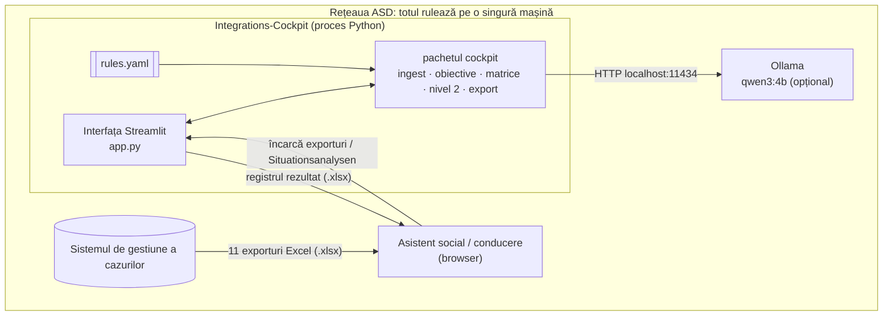

Nu există nicio conexiune cu sistemul de gestiune a cazurilor. Datele intră prin **upload** și
ies prin **download**, de fiecare dată ca fișiere Excel. Nimic nu e păstrat pe server.
Singura excepție este cache-ul JSONL opțional al extragerii LLM din linia de comandă, care
conține etichetele extrase, nu textul sursă.

### 3.2 Straturi și dependențe între module

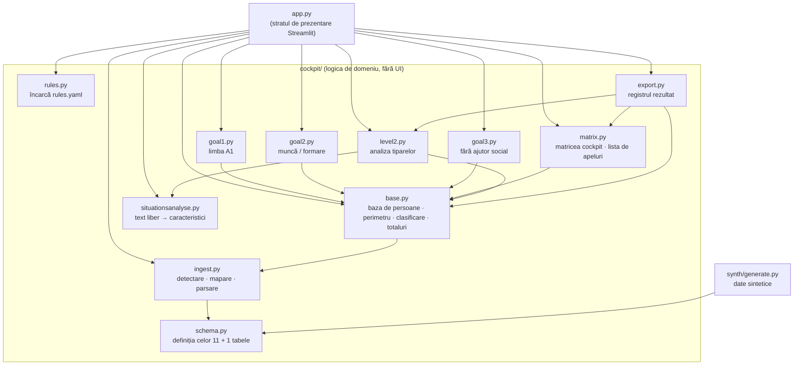

Pachetul `cockpit` **nu importă Streamlit**. Fiecare funcție primește DataFrame-uri și un dicționar
de reguli și întoarce DataFrame-uri sau dataclass-uri. Așa logica se testează cu pytest simplu
și se poate folosi din linia de comandă. Doar `app.py` știe de widgeturi, cache și starea sesiunii.

### 3.3 Decizii de proiectare

| Decizie | Motiv |
|---|---|
| Excel la intrare, Excel la ieșire | Utilizatorii lucrează deja în Excel, iar sistemul sursă exportă doar Excel. Nu e nevoie de un proiect de integrare. |
| Fișierele sunt recunoscute după **coloane**, nu după nume | Numele fișierelor exportate nu sunt stabile, antetele coloanelor sunt. |
| Toate regulile neclare sunt în `rules.yaml` | Textul challenge-ului lasă mai multe reguli ambigue. Fiecare e o setare, deci o lămurire nu cere modificarea codului. |
| Prelucrare fără stare, în memorie | Nicio dată personală stocată, nimic de securizat sau de șters. |
| Tiparele se afișează doar pe grupuri | Evită profilarea indivizilor; grup minim de 10. |
| Doar LLM local | Rapoartele în text liber conțin informații personale sensibile și nu au voie să părăsească rețeaua. |
| Logica de domeniu separată de UI | Testabilitate; aceleași funcții servesc linia de comandă și interfața. |

## 4. Modulele

| Modul | Linii | Responsabilitate | Puncte de intrare |
|---|---|---|---|
| `cockpit/schema.py` | 213 | Declară cele 11 tabele de export (+ tabelul cu caracteristicile Situationsanalyse): câmp canonic → antete acceptate, câmpuri-semnătură, câmpuri de tip dată | `TABLES`, `KEY_COLUMNS`, `export_headers()` |
| `cockpit/ingest.py` | 206 | Citește registrele, detectează tabelul fiecărei foi, mapează antetele, curăță cheile, parsează datele, verifică integritatea referențială | `load_exports()`, `load_directory()`, `LoadResult`, `Issue` |
| `cockpit/rules.py` | 10 | Încarcă `rules.yaml` | `load_rules()` |
| `cockpit/base.py` | 246 | Elemente comune: un rând per client, statut, data intrării, sfârșitul responsabilității, perimetru, semafor, totaluri | `prepare_persons()`, `apply_scope()`, `classify()`, `finish()`, `restrict()`, `GoalResult` |
| `cockpit/goal1.py` | 103 | Obiectivul 1: limba la nivel A1 în 3 ani de la intrare | `evaluate_goal1()` |
| `cockpit/goal2.py` | 168 | Obiectivul 2: 6 luni de muncă ≥ 60 % sau formare Sek II / terțiară | `evaluate_goal2()`, `qualifying_runs()` |
| `cockpit/goal3.py` | 128 | Obiectivul 3: gospodăria 12 luni fără ajutor social | `evaluate_goal3()`, `free_spells()`, `household_heads()` |
| `cockpit/matrix.py` | 86 | Unește cele trei obiective per persoană, prioritate, lista de apeluri | `cockpit_matrix()`, `call_list()`, `matrix_table()` |
| `cockpit/level2.py` | 231 | Comparații pe grupuri, intervale Wilson, V-ul lui Cramér, combinații de caracteristici | `analyse()`, `Level2Result` |
| `cockpit/situationsanalyse.py` | 296 | Parsează rapoartele, elimină datele personale, extrage 5 caracteristici prin reguli sau LLM; are și o interfață în linia de comandă | `extract_documents()`, `extract_rules()`, `extract_llm()`, `evaluate()` |
| `cockpit/export.py` | 111 | Construiește registrul rezultat formatat | `build_workbook()`, `unit_table()` |
| `app.py` | 314 | Interfața Streamlit | se pornește cu `streamlit run app.py` |
| `synth/generate.py` | 507 | Exporturi și rapoarte sintetice, cu un tipar plantat și erori intenționate | `python -m synth.generate` |

## 5. Modelul de date

Cele unsprezece exporturi sunt legate prin trei chei. Unele tabele au doar **numărul Zemis**
(federal); `base.with_client()` îl traduce în **Klientennummer** (numărul intern de client) prin
tabelul `Klient`. **Dossier-Nr.** grupează persoanele într-o gospodărie (*Unterstützungseinheit*).

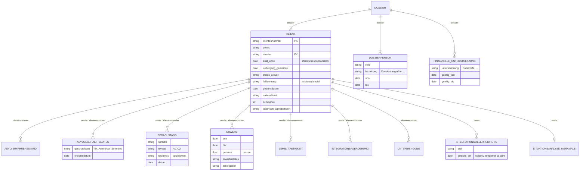

Diagrama arată doar câmpurile importante; lista completă, cu fiecare variantă de antet acceptată,
e în [`cockpit/schema.py`](../../cockpit/schema.py). Șase exporturi au venit cu un șablon de la
organizatori (`template_received: True`). Celelalte cinci (Klient, Sprachstand,
Integrationsförderung, Integrationszielerreichung, Unterbringung) au fost deduse din modelul de
date din [`doc/datenmodell.html`](../datenmodell.html) și trebuie verificate cu exporturi reale.

`situationsanalyse_merkmale` e un al doisprezecelea tabel, definit de aplicație. Conține
rezultatul extragerii din text liber după ce l-a verificat un om și se încarcă la fel ca orice
alt export.

## 6. Fluxul de date de la un capăt la altul

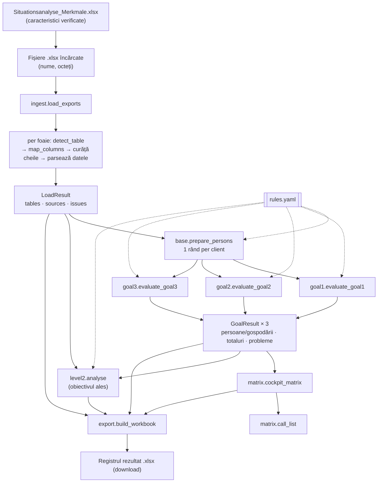

Fluxul merge într-o singură direcție: niciun pas nu scrie înapoi într-unul anterior. Fiecare pas
adaugă obiecte `Issue` (gravitate `Fehler` = eroare / `Warnung` = avertisment / `Info`), pe care
interfața le concatenează și le deduplică în fila *Datenqualität* (calitatea datelor).

## 7. Ingest: de la fișiere Excel oarecare la tabele canonice

`ingest.load_exports(files)` primește o listă de perechi `(nume, octeți)` și întoarce un
`LoadResult(tables, sources, issues)`.

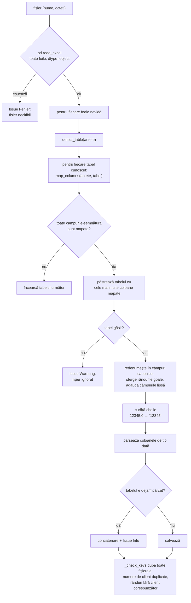

**Maparea antetelor** (`map_columns`) are două treceri:

1. **Potrivire exactă** după normalizare: litere mici, punctuația devine spațiu, spațiile
   multiple se comprimă; umlauturile, `ß` și `%` se păstrează.
2. **Potrivire pe prefix**, pentru antete cu un sufix explicativ, de exemplu
   `Geburtsdatum (für «ab 16 J.»)`. Contează doar aliasurile mai lungi de 5 caractere și câștigă
   cel mai lung.

Fiecare câmp canonic e atribuit cel mult o dată. Coloanele necunoscute sunt raportate ca `Info`
și eliminate.

**Detectarea tabelului** (`detect_table`) cere ca toate câmpurile-*semnătură* ale tabelului să
fie mapate, de exemplu `zust_ende` + `geburtsdatum` pentru `Klient`. Dintre candidați câștigă
tabelul cu cele mai multe coloane mapate. Așa se deosebesc exporturile care au antete generice
comune, ca `Von`, `Bis` sau `Art`.

**Datele calendaristice** (`parse_date`) acceptă, în această ordine: obiecte dată pandas/Python;
numere seriale Excel între 10.000 și 80.000; și șirurile `dd.mm.yyyy`, `dd.mm.yy`, `yyyy-mm-dd`,
`yyyy-mm-dd HH:MM:SS` și `dd/mm/yyyy`. O valoare imposibil de parsat devine `NaT` și produce un
singur `Warnung` per coloană, cu până la trei exemple. Trei exporturi livrează datele ca text,
restul ca date Excel; datele sintetice le acoperă pe ambele.

**Cheile** (`klientennummer`, `zemis`, `dossier`) sunt normalizate la șiruri. Excel transformă
adesea `12345` în `12345.0`, ceea ce altfel ar strica orice join.

**Mai multe fișiere sau foi pentru același tabel** sunt concatenate, iar intrarea din `sources`
le listează pe toate.

## 8. Baza de persoane

`base.prepare_persons(tables, rules, stichtag)` construiește DataFrame-ul de la care pleacă
fiecare obiectiv: un rând per Klientennummer, indexat după ea.

| Coloană derivată | Cum se obține |
|---|---|
| `verfahrensstand` | `Klient.status_aktuell`; dacă e gol, intrarea din `Asylverfahrensstand` valabilă la Stichtag (`gueltig_ab ≤ Stichtag ≤ gueltig_bis`, câștigă cea mai recentă `gueltig_ab`) |
| `status_basis` | Statutul fără sufix (`B-FL+5` → `B-FL`, regex `status.strip_suffix_pattern`) |
| `einreise` | Cel mai vechi (sau cel mai nou, `entry.pick`) eveniment `Asylgeschäftsdaten` de tip `Aufenthalt (Einreise)`; varianta de rezervă `Aufenthalt (Geburt)`, pentru copiii născuți în Elveția |
| `asylgesuch` | Cel mai vechi eveniment al cărui tip se potrivește cu `entry.application_event_pattern` (`^asylgesuch`) |
| `zust_ende_eff` | `Zuständigkeitsende` (sfârșitul responsabilității) din export; dacă lipsește, se calculează din statut: B-FL/B-RSFL/B-SL → cererea + 5 ani, VA/F-FL → intrarea + 7 ani (5 ani pentru intrările de la `rule_change_date`, 01.01.2027) |
| `zust_ende_quelle` | `Export` sau `berechnet` (calculat), afișat ca un termen calculat să nu fie confundat cu unul înregistrat |
| `alter_stichtag`, `einreisejahr` | Vârsta la Stichtag, anul intrării |

### 8.1 Perimetrul

`apply_scope()` scrie două indicatoare, cu scopuri diferite:

- **`im_scope`**: persoana e client *actual* și obiectivul i se aplică. Se folosește pentru
  semafoare și pentru lista de apeluri.
- **`zielgruppe`**: obiectivul i se aplică persoanei, **indiferent** dacă mai e client. Îl
  folosește nivelul 2, pentru că tiparele se pot învăța doar din cazurile cu rezultat cunoscut,
  iar acestea sunt în mare parte foști clienți.

Motivul pentru care o persoană e în afara perimetrului rămâne în `grund_nicht_anwendbar`.
Verificările se fac în această ordine și câștigă prima care se potrivește: responsabilitate
încheiată → predat la comună → statut necunoscut → statut neeligibil (S, N) → lipsește o dată
necesară → sub vârsta minimă, măsurată la `age_reference` (implicit, la termen).

### 8.2 Clasificarea

`classify(p, stichtag, risk_months)` transformă `frist` (termenul), `erreicht_am` (atins la) și o
dată estimată de finalizare opțională, `laufend_fertig_am`, într-un statut și un semafor:

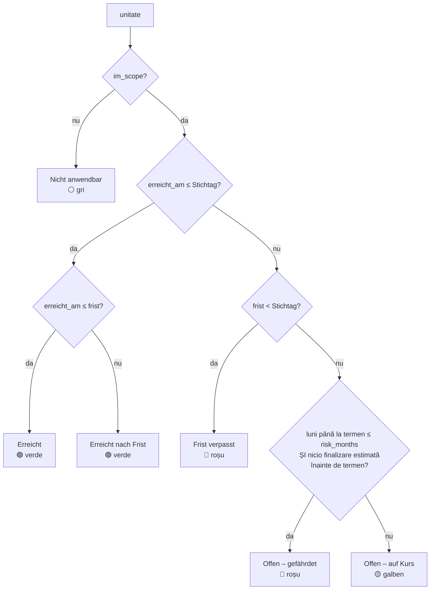

Statuturile: *Erreicht* = atins, *Erreicht nach Frist* = atins după termen, *Frist verpasst* =
termen ratat, *Offen – gefährdet* = deschis, în pericol, *Offen – auf Kurs* = deschis, pe drumul
cel bun, *Nicht anwendbar* = nu se aplică.

`risk_months` este 6 pentru obiectivul 1 și 12 pentru obiectivele 2 și 3. Data estimată de
finalizare împiedică un caz cu un loc de muncă în curs, la normă întreagă, să devină roșu:
jobul va îndeplini obiectivul la timp, deci cazul rămâne galben.

`finish()` pune totul într-un `GoalResult`: tabelul de unități, totalurile pe asistent social și
pe anul intrării, totalurile generale, problemele și numele coloanelor afișate. `restrict()`
întoarce aceeași structură pentru o submulțime, de exemplu cazurile unui asistent social, cu
totalurile recalculate.

## 9. Evaluarea obiectivelor

Cele trei funcții de evaluare au aceeași semnătură:
`evaluate_goalN(tables, rules, stichtag, persons=None) -> GoalResult`. Ridică `ValueError` când
lipsește un export necesar; interfața afișează mesajul și păstrează celelalte obiective.

### 9.1 Obiectivul 1: limba la nivel A1

| | |
|---|---|
| Unitate | persoană |
| Necesită | `klient`, `asylgeschaeftsdaten`, `sprachstand` |
| Termen | data intrării + `goal1.deadline_years` (3) |
| În perimetru | statut VA/FL, cel puțin 16 ani la termen |

Un rând `Sprachstand` (nivel lingvistic) se califică dacă nivelul e cel puțin `min_level` (`A1`,
ordinea A0 < A1 < … < C2), limba e în `languages` (germană, franceză) și tipul de dovadă e în
`accepted_proofs`. Contează rândul calificat **cu cea mai veche dată**. Un rând calificat fără
dată e raportat și nu se ia în calcul.

Rândurile `Integrationszielerreichung` care se potrivesc cu `reached_goal_pattern` dau o a doua
sursă: obiectivul *înregistrat pentru plată*. `erreicht_am` este cea mai veche dintre cele două
date.

Din compararea celor două surse rezultă două verificări de reconciliere:

- *înregistrat, dar fără dovadă lingvistică* → `Info`;
- **A1 dovedit la timp, dar niciodată înregistrat ca atins** → `Info` „Abgeltung prüfen”
  (verifică plata). Aceasta e constatarea cu „banii găsiți”: fiecare caz e o plată pe care
  serviciul o poate avea de încasat.

### 9.2 Obiectivul 2: muncă sau formare

| | |
|---|---|
| Unitate | persoană |
| Necesită | `klient` și cel puțin unul dintre `erwerb` / `integrationsfoerderung` |
| Termen | sfârșitul efectiv al responsabilității |
| Atins | `min_months` (6) fără întrerupere la ≥ `min_pensum` (60 %), **sau** o formare de tip `education_types` (Sek II, terțiar), socotită de la `start` sau de la `abschluss` (absolvire) |

Joburile sunt pregătite înainte de calculul pe axa timpului:

- joburile fără dată de sfârșit se termină la Stichtag; cele fără procent de normă sunt
  raportate și eliminate;
- `erwerbsstatus` (forma de angajare) e filtrat după `erwerbsstatus_counts`;
- angajatorii care se potrivesc cu `exclude_employer_pattern` sunt eliminați. Exportul nu are un
  câmp pentru piața primară a muncii, așa că programele de ocupare sunt recunoscute după nume.

`qualifying_runs()` găsește perioadele în care norma totală e suficient de mare. Cu
`sum_parallel_jobs: true` e o **linie de baleiaj** peste schimbările de normă: +normă în ziua de
început, −normă în ziua de după sfârșit. Așa, două joburi paralele de 30 % se socotesc 60 %:

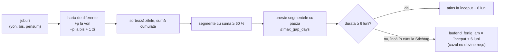

Un job calificat în curs produce și un indiciu („obiectiv îndeplinit la zz.ll.aaaa”), pe care
lista de apeluri îl afișează.

**Verificarea încrucișată cu ZEMIS.** `_zemis_check()` compară anunțurile de muncă din sistemul
federal ZEMIS cu exportul `Erwerb`, cu o toleranță de ±31 de zile. Munca știută de ZEMIS, dar
absentă din `Erwerb`, e semnalată ca `Warnung` și ca indiciu la persoană: poate fi muncă
neînregistrată care îndeplinește deja obiectivul.

### 9.3 Obiectivul 3: fără ajutor social

| | |
|---|---|
| Unitate | **gospodărie** (Dossier-Nr.) |
| Necesită | `klient`, `finanzielle_unterstuetzung` |
| Termen | sfârșitul responsabilității pentru titularul dosarului (`household_deadline: dossiertraeger`); alternativ cel mai târziu sau cel mai devreme dintre toți membrii |
| Atins | 12 luni la rând (`min_months`) fără ajutor de tipul `assistance_types` (Sozialhilfe = ajutor social, Nothilfe = ajutor de urgență) |

`household_heads()` ia `Dossierträger/-in` (titularul dosarului) activ din `Dossierperson`. Dacă
nu există, alege membrul cel mai în vârstă. Rândul gospodăriei moștenește statutul și perimetrul
titularului.

`free_spells()` calculează pauzele dintre perioadele de ajutor, de la prima intrare înregistrată
până la Stichtag:

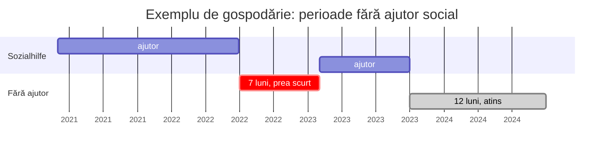

O gospodărie fără nicio intrare în `Finanzielle Unterstützung` e exclusă cu un motiv explicit,
în loc să fie socotită „niciodată la ajutor social”.

## 10. Matricea cockpit și lista de apeluri

`cockpit_matrix(r1, r2, r3)` pornește de la persoanele obiectivului 1 și adaugă prin left join,
pentru fiecare obiectiv, statutul, semaforul, termenul, lunile rămase, perimetrul și indiciul.
Coloanele au prefixele `z1_`, `z2_`, `z3_`. Obiectivul 3 se leagă prin dosar și contează doar
pentru titular, ca gospodăria să nu fie numărată o dată pentru fiecare membru. Persoanele care
nu sunt în perimetrul niciunui obiectiv sunt eliminate.

- **Prioritatea** (`prioritaet`) este cel mai rău semafor dintre obiectivele *deschise* ale
  persoanei, adică `Offen – gefährdet` sau `Offen – auf Kurs`.
- **Următorul termen deschis** este cel mai apropiat termen dintre aceste obiective deschise.
- Rândurile se sortează după prioritate (roșu → galben → verde → gri), apoi după următorul
  termen deschis.

`call_list(matrix, limit=15)` transformă primele rânduri prioritizate în carduri. Fiecare card
listează toate obiectivele deschise, cu un motiv în cuvinte simple, termenul, lunile rămase și
eventualul indiciu, întâi cele roșii.

În rolul de asistent social, `app.py` restrânge matricea și fiecare `GoalResult` la
`fallfuehrung == <asistentul ales>` înainte de afișare.

## 11. Nivelul 2: analiza tiparelor

`level2.analyse(result, tables, rules, extra)` răspunde la întrebarea: *ce au în comun persoanele
care au atins obiectivul la timp?*

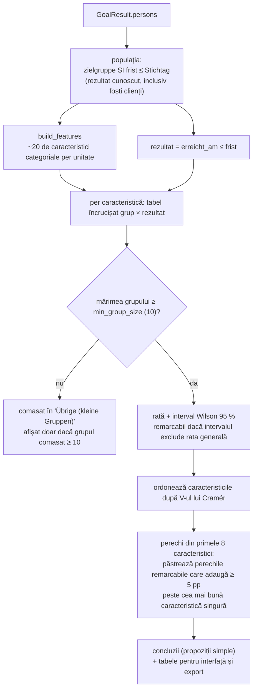

**Caracteristicile**, toate pe intervale sau categoriale:

- vârsta la intrare, sexul, naționalitatea, limba maternă;
- anii de școală, alfabetizarea în scriere latină, cel mai înalt nivel de studii, experiența de
  muncă, anul intrării;
- rolul în gospodărie și mărimea gospodăriei (din `Dossierperson`); un copil sub 4 ani în
  gospodărie la intrare;
- primul curs de germană după intrare, intensitatea cursului, curs de alfabetizare urmat (din
  `Integrationsförderung`);
- locuința la 12 luni după intrare (`Unterbringung`);
- cele cinci caracteristici Situationsanalyse, dacă fișierul verificat a fost încărcat;
- pentru obiectivele 2 și 3 se adaugă prin `extra` „Obiectivul 1 (A1) atins”;
- asistentul social e caracteristică **doar** dacă `level2.include_case_worker` este `true`;
  implicit e dezactivat, pentru că ar însemna evaluarea angajaților.

**Statistica**:

- intervalul de scor Wilson: `centru ± z·√(p(1−p)/n + z²/4n²) / (1 + z²/n)`, cu z = 1,96;
- V-ul lui Cramér: calculat din χ² al tabelului încrucișat grup × rezultat. Rezultatul fiind
  binar, se reduce la √(χ²/n);
- grupurile `unbekannt` (necunoscut), `unklar` (neclar) și `keine Situationsanalyse` (fără
  analiză a situației) sunt excluse din combinații și din concluzii.

**Garanțiile de confidențialitate** (fiecare fixată printr-un test):

- nicio valoare nu e întoarsă vreodată per persoană;
- niciun grup sub `min_group_size` nu e afișat;
- grupurile mici sunt comasate într-unul singur doar dacă acesta atinge minimul;
- o populație sub minim produce un singur mesaj și niciun tabel.

Interfața și exportul afișează mereu o rezervă: asocierile sunt descriptive, nu cauzale.
Cursurile se dau persoanelor cu nevoi mai mari, deci o rată de reușită mai mică la participanții
la curs nu înseamnă că acesta dăunează.

## 12. Situationsanalyse: de la text liber la caracteristici

Situationsanalyse este un formular Word cu câte o secțiune pentru fiecare membru al gospodăriei.
Extragerea îl transformă în cinci caracteristici per persoană.

| Caracteristică | Valori |
|---|---|
| `psychische_belastung` (povară psihică) | ja / nein / unklar |
| `lernmotivation` (motivație de învățare) | hoch / mittel / tief / unklar |
| `lerntempo` (ritm de învățare) | schnell / mittel / langsam / unklar |
| `betreuung_hindernis` (obligații de îngrijire ca obstacol) | ja / nein / unklar |
| `soziales_netz` (rețea socială) | gut / schwach / unklar |

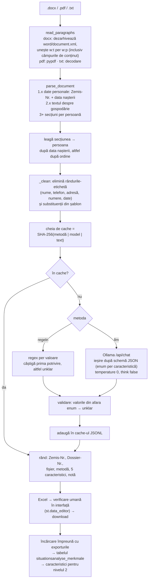

- **Datele personale sunt eliminate înainte de orice extragere.** Rândurile care încep cu
  etichete ca nume, prenume, telefon, e-mail, stradă, cod poștal, număr N sau Zemis, asistentul
  social, data nașterii sau data intrării sunt eliminate. Modelul nu le vede; ajung la el doar
  textul despre gospodărie și secțiunile persoanei.
- **Ieșirea LLM e constrânsă.** Parametrul `format` al Ollama primește o schemă JSON cu un `enum`
  pentru fiecare caracteristică. Răspunsul e oricum validat, iar orice valoare din afara enum
  devine `unklar`.
- **Rulările în lot se pot relua.** Linia de comandă (`python -m cockpit.situationsanalyse
  <folder> --methode llm --cache fisier.jsonl --workers N`) adaugă fiecare rezultat într-un cache
  JSONL, așa că o rulare întreruptă continuă de unde a rămas. Un pool de fire cu un lacăt
  protejează cache-ul și contorul de progres.
- **Un om rămâne în buclă.** Rezultatul e un fișier Excel pe care un specialist îl verifică și
  îl corectează în tabelul editabil, înainte de a-l încărca.
- **Calitatea e măsurată.** Pe datele sintetice, `evaluate()` compară extragerea cu
  `data/situationsanalyse_ground_truth.csv` și raportează rata de potrivire per caracteristică.
  Interfața o arată pentru fiecare metodă disponibilă. Regulile sunt acordate pe formulările
  rapoartelor sintetice; pe rapoarte reale, LLM-ul e de așteptat să fie mai robust, iar asta
  trebuie măsurat pe rapoarte reale, anonimizate.

Pe CPU, LLM-ul are nevoie de aproximativ 20 de secunde per persoană.

## 13. Exportul Excel

`export.build_workbook(results, rules, issues, sources, level2, matrix)` întoarce octeții unui
fișier `.xlsx` cu aceste foi:

| Foaie | Conținut |
|---|---|
| Übersicht | Stichtag, totaluri per obiectiv, fișierul sursă al fiecărui tabel |
| Cockpit (alle Ziele) | Matricea: un rând per persoană, statut și termen per obiectiv |
| Ziel N – Personen / Haushalte | Tabelul de unități sortat roșu → verde, apoi după termen |
| Ziel N – Fallführung | Totaluri per asistent social |
| Ziel N – Einreisejahr | Totaluri per an de intrare |
| Datenqualität | Toate problemele |
| Annahmen | `rules.yaml` aplatizat în rânduri cheie/valoare |
| Muster ZN – … | Concluzii cu rezerva, clasamentul caracteristicilor, grupuri, combinații (obiectivul ales, doar pentru rolul de conducere) |

Formatarea: antet albastru-închis îngroșat, primul rând înghețat, filtru automat, lățimea
coloanelor potrivită conținutului (între 10 și 60 de caractere), date `DD.MM.YYYY`, procente
`0.0%`, rânduri sau celule colorate după semafor. Numele foilor sunt tăiate la limita Excel de
31 de caractere.

Butonul de download primește o **funcție**, așa că registrul e construit doar la apăsare.

## 14. Aplicația Streamlit

### 14.1 Ciclul unei cereri și cache-ul

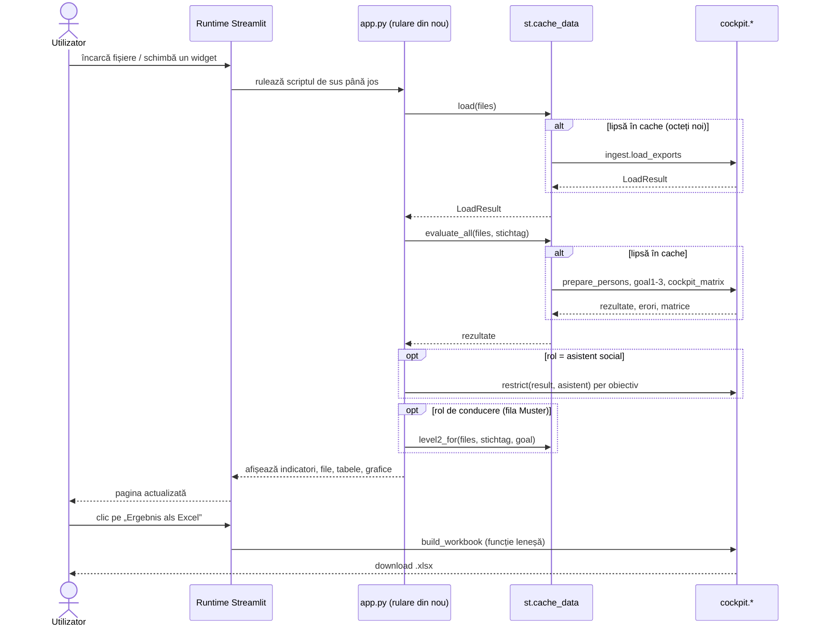

Cheile de cache sunt tuplul `(nume fișier, octeții fișierului)` și Stichtag, așa că schimbarea
datei sau a fișierelor invalidează exact ce depinde de ele. Schimbarea rolului, a obiectivului
sau a filei nu recalculează niciun obiectiv. `rules.yaml` **nu** face parte din cheie; vezi
[secțiunea 15](#15-reguli-și-configurare).

### 14.2 Structura ecranului

| Zonă | Conținut |
|---|---|
| Bara laterală · Daten | Sursa: date demo sintetice sau fișiere proprii; alegerea fișierului cu caracteristici Situationsanalyse (reguli / LLM local); Stichtag |
| Bara laterală · Ziel / Ansicht | Obiectivul 1–3; rolul *Leitung* (conducere) sau *Sozialarbeiter:in* (asistent social), plus alegerea asistentului; descărcarea rezultatului |
| Antet | Șase indicatori: în perimetru, atinși, pe drumul cel bun, în pericol, ratați, rata la timp |
| File (conducere) | Cockpit · Übersicht · Muster · Situationsanalysen · Liste · Datenqualität · Annahmen |
| File (asistent social) | Wen rufe ich an? · Cockpit · Übersicht · Liste · Datenqualität · Annahmen |

`.streamlit/config.toml` leagă serverul de `localhost`, rulează fără interfață proprie
(headless), dezactivează statisticile de utilizare (`gatherUsageStats = false`), permite upload
de până la 200 MB și setează tema deschisă cu culoarea principală `#1F4E78`.

## 15. Reguli și configurare

Fiecare regulă de business pe care challenge-ul o lasă deschisă se află în
[`rules.yaml`](../../rules.yaml), cu un comentariu explicativ. Cheile principale:

| Cheie | Implicit | Semnificație |
|---|---|---|
| `current_clients.require_responsibility_active` | `true` | Client actual = sfârșitul responsabilității gol sau ≥ Stichtag |
| `current_clients.exclude_after_handover` | `true` | Predat la comună = nu mai e client |
| `status.strip_suffix_pattern` | `\+\d+$` | `B-FL+5` → `B-FL` |
| `status.eligible` | VA, F-FL, B-FL, B-RSFL, B-SL | Statuturile cărora li se aplică obiectivele |
| `entry.event` / `fallback_events` / `pick` | Aufenthalt (Einreise) / Aufenthalt (Geburt) / earliest | Data intrării |
| `responsibility.*` | 5 ani de la cerere / 7 de la intrare; 5 de la intrare după 01.01.2027 | Sfârșitul responsabilității calculat, când exportul nu îl are |
| `goal1.deadline_years`, `min_age`, `age_reference` | 3, 16, deadline | |
| `goal1.accepted_proofs` | telc, fide, limba maternă, … | Listă goală = contează orice tip de dovadă |
| `goal2.min_pensum`, `min_months`, `sum_parallel_jobs`, `max_gap_days` | 60, 6, true, 0 | |
| `goal2.exclude_employer_pattern` | Beschäftigungsprogramm, … | Piața secundară a muncii |
| `goal2.education_types`, `education_counts_from` | Sek II, Tertiär · start | |
| `goal3.assistance_types`, `household_deadline` | Sozialhilfe, Nothilfe · dossiertraeger | |
| `goalN.reached_goal_pattern` | regex | Se potrivește cu `Integrationszielerreichung.ziel` |
| `goalN.risk_months` | 6 / 12 / 12 | Fereastra pentru „în pericol” |
| `level2.min_group_size` | 10 | Cel mai mic grup afișat vreodată |
| `level2.include_case_worker` | `false` | Doar cu acordul angajaților |

Fila *Annahmen* (ipoteze) afișează fișierul, iar exportul îl conține.

**Capcana cache-ului.** `app.py` citește `rules.yaml` la fiecare rulare, dar `evaluate_all()` și
`level2_for()` apelează `load_rules()` *în interiorul* unor funcții memorate după
`(files, stichtag)`. Un fișier de reguli modificat e deci afișat imediat, dar folosit abia după
golirea cache-ului (meniul Streamlit → *Clear cache*) sau după repornirea procesului. Adăugarea
unui hash al conținutului fișierului în cheia de cache ar elimina capcana.

## 16. Generatorul de date sintetice

`python -m synth.generate --out data/synthetic --households 220 --seed 42` scrie cele unsprezece
exporturi, câte un `.docx` Situationsanalyse pentru fiecare gospodărie în
`data/situationsanalysen/` și adevărul de referință în `data/situationsanalyse_ground_truth.csv`.
Nu sunt implicate persoane reale.

- **Determinist:** `random.Random` cu sămânță. Un al doilea generator (`seed + 7`) e folosit
  pentru adăugiri, așa că extinderea generatorului nu schimbă datele existente.
- **Structură realistă:** amestecul de statuturi, opt naționalități cu limbi, alfabet și ani de
  școală tipici, gospodării cu parteneri și copii, copii născuți în Elveția, mutări de locuință,
  cursuri, joburi, perioade de ajutor social. Antetele vin din `schema.export_headers()`, iar trei
  tabele scriu datele ca text, ca exporturile reale.
- **Un tipar plantat**, ca nivelul 2 să aibă ce găsi. Șansa de a atinge A1 e o funcție logistică
  de anii de școală, alfabetizarea în scriere latină, vârstă, abilitatea asistentului social și
  trăsăturile ascunse din Situationsanalyse (povară, motivație, îngrijire, rețea socială).
  `tests/test_level2.py` verifică faptul că analiza îl găsește.
- **Erori intenționate**, ca verificarea calității datelor să aibă ce raporta: o dată invalidă
  (`31.02.2023`), certificate A1 fără dată, o înregistrare lingvistică pentru un client inexistent.

## 17. Teste

```powershell
.venv\Scripts\python.exe -m pytest -q
```

Testele se rulează din rădăcina proiectului cu `python -m pytest`; `-m` pune rădăcina pe
`sys.path`. Sunt 35 de funcții de test, care prin parametrizare rulează ca 54 de cazuri:

| Fișier | Teste | Ce acoperă |
|---|---|---|
| `test_ingest.py` | 6 | Detectarea tabelului, antetele cu prefix, datele elvețiene și cele invalide, fișiere necunoscute, recunoașterea șabloanelor primite de la organizatori |
| `test_goal1.py` | 8 | Categoriile de statut, motivele de excludere din perimetru, vârsta la termen, regulile de dovadă, cea mai veche dovadă față de obiectivul înregistrat, varianta de rezervă pentru nașterea în Elveția, tabel lipsă, ordonarea nivelurilor |
| `test_goal2_3.py` | 8 | Joburi paralele și pauze, programe excluse, un job în curs menține cazul pe drumul cel bun, verificarea ZEMIS, sfârșitul responsabilității calculat, perioade fără ajutor, gospodării, obiectivul 3 doar pentru titular în lista de apeluri |
| `test_level2.py` | 7 | Intervalul Wilson, populația limitată la rezultate cunoscute, **grupurile mici nu apar niciodată, nicio ieșire per persoană**, tiparul plantat e găsit, populație prea mică, comasare |
| `test_situationsanalyse.py` | 6 | Legătura secțiune ↔ Zemis, **datele personale eliminate înainte de extragere**, regulile față de adevărul de referință, ieșirea LLM validată, text simplu și cache |

Majoritatea testelor își construiesc datele cu generatorul sintetic, în fixture-uri. Singura
excepție este `test_received_templates_are_recognized`, care citește șabloanele organizatorilor
din `doc/`.

## 18. Protecția datelor și securitate

| Amenințare | Măsură |
|---|---|
| Date stocate | Aplicația nu scrie nimic: fișierele încărcate stau în memorie și în cache-ul din proces al Streamlit |
| Date care părăsesc rețeaua | Server legat de `localhost`; statistici de utilizare oprite; LLM local (Ollama pe `localhost:11434`); niciun apel către API-uri externe |
| Date personale în textul liber | Rândurile de identificare sunt eliminate înainte de extragere; ies doar cinci etichete categoriale |
| Profilarea indivizilor | Nivelul 2 afișează doar grupuri ≥ 10; niciodată o valoare per persoană; asistentul social dezactivat implicit |
| Concluzii greșite | Rezervă pe fiecare vizualizare de tipare; termenele calculate sunt marcate `berechnet` |
| Erori de date care distorsionează tăcut rezultatele | Fiecare rând eliminat, dată imposibil de parsat și cheie fără corespondent devine o problemă vizibilă |

**Ce nu acoperă prototipul:** nu are autentificare și nici control al rolurilor. Comutarea
rolului e un filtru de afișare, nu un control de acces. Aplicația trebuie rulată pe o mașină de
încredere sau, dacă e expusă vreodată în afara `localhost`, în spatele unui reverse proxy cu
autentificare.

## 19. Pipeline-ul video demo

`tools/demo-video/` generează videoclipul de pitch în mod reproductibil. Nu e necesar pentru
rularea aplicației.

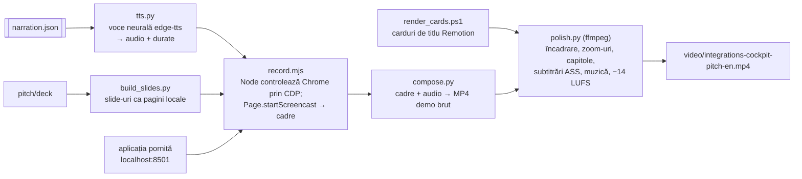

Fișierul muzical nu e în repository (licența Pixabay); `assets/music/CREDITS.txt` îl numește.

## 20. Extinderea aplicației

| Sarcină | Unde |
|---|---|
| Un export real folosește alt antet | Adaugă varianta în lista de aliasuri a câmpului din `cockpit/schema.py`. Primul alias e cel pe care îl scrie generatorul. |
| O regulă de business e lămurită | Schimbă valoarea în `rules.yaml`; codul rămâne neschimbat. |
| Un parametru de regulă nou | Adaugă-l în `rules.yaml` cu un comentariu și citește-l cu `.get(cheie, implicit)` în modulul obiectivului, ca fișierele de reguli mai vechi să funcționeze în continuare. |
| Un tabel de export nou | Adaugă o intrare în `TABLES` cu `columns`, o `signature` unică și `dates`; apoi folosește-l prin `tables.get(nume)`. |
| Un al patrulea obiectiv | Un `goalN.py` nou care întoarce un `GoalResult` construit cu `apply_scope`, `classify` și `finish`; înregistrează-l în `GOALS` din `app.py` și leagă-l în `cockpit_matrix`. |
| O caracteristică nouă pentru nivelul 2 | Adaugă o coloană în `level2.build_features`. Gruparea, intervalele și filtrele de confidențialitate se aplică automat. |
| O caracteristică Situationsanalyse nouă | Adaug-o în `FEATURES` cu valori, definiție și reguli; schema și promptul LLM se derivă din ea. Adaugă coloana în `schema.TABLES["situationsanalyse_merkmale"]`. |

## 21. Limitări cunoscute

- Cinci structuri de export sunt deduse din modelul de date, nu din șabloane reale, și trebuie
  verificate cu exporturi reale.
- Regulile pe cuvinte cheie sunt acordate pe formulările sintetice; precizia lor pe rapoarte
  reale e necunoscută.
- Nivelul 2 e descriptiv. Efectele de selecție (cine primește ce curs) nu sunt modelate.
- Un singur utilizator per proces, totul în memorie. Exporturile foarte mari sunt limitate de
  RAM și de limita de upload de 200 MB.
- Fără autentificare; comutarea rolului nu e o barieră de securitate.
- Interfața e doar în germană.
