# Integrations-Cockpit: manual de utilizare

*Pentru asistenții sociali și conducerea Asylsozialdienst.*
*Versiuni: [English](../en/user-manual.md) · Română (acest fișier)*

Vezi și: [Instalare și configurare](instalare.md) · [Documentație tehnică](documentatie-tehnica.md)

> Capturile de ecran arată **datele demo sintetice**. Niciuna dintre persoane nu e reală.
> Interfața aplicației e în germană; manualul dă fiecare etichetă în germană, urmată de
> semnificația ei.

---

## Cuprins

1. [Ce face cockpit-ul pentru tine](#1-ce-face-cockpit-ul-pentru-tine)
2. [Cele trei obiective și semaforul](#2-cele-trei-obiective-și-semaforul)
3. [Deschiderea aplicației](#3-deschiderea-aplicației)
4. [Ecranul pe scurt](#4-ecranul-pe-scurt)
5. [Încărcarea datelor](#5-încărcarea-datelor)
6. [Alegerea obiectivului și a rolului](#6-alegerea-obiectivului-și-a-rolului)
7. [Pentru asistenții sociali: „Wen rufe ich an?”](#7-pentru-asistenții-sociali-wen-rufe-ich-an)
8. [Cockpit: toate obiectivele per persoană](#8-cockpit-toate-obiectivele-per-persoană)
9. [Übersicht: pe ani de intrare și pe asistenți sociali](#9-übersicht-pe-ani-de-intrare-și-pe-asistenți-sociali)
10. [Liste: lista detaliată per obiectiv](#10-liste-lista-detaliată-per-obiectiv)
11. [Datenqualität: ce trebuie corectat și bani de recuperat](#11-datenqualität-ce-trebuie-corectat-și-bani-de-recuperat)
12. [Muster: ce au în comun persoanele care reușesc](#12-muster-ce-au-în-comun-persoanele-care-reușesc)
13. [Situationsanalysen: din rapoarte în text liber, caracteristici](#13-situationsanalysen-din-rapoarte-în-text-liber-caracteristici)
14. [Annahmen: regulile în vigoare](#14-annahmen-regulile-în-vigoare)
15. [Rezultatul în Excel](#15-rezultatul-în-excel)
16. [O lună obișnuită](#16-o-lună-obișnuită)
17. [Glosar](#17-glosar)
18. [Întrebări frecvente](#18-întrebări-frecvente)

---

## 1. Ce face cockpit-ul pentru tine

Cockpit-ul citește exporturile Excel pe care le primești deja din sistemul de gestiune a
cazurilor și răspunde la trei întrebări:

- **Cine e pe drumul cel bun și cine e în pericol?** Pentru fiecare client și fiecare obiectiv de
  integrare arată un termen și un semafor.
- **Pe cine sun săptămâna asta?** Fiecare asistent social primește o listă cu propriile cazuri,
  cele mai urgente primele, cu motivul scris.
- **Ce lipsește sau e greșit în date?** Arată, de exemplu, obiectivele atinse dar
  neînregistrate. Fiecare e o plată de verificat.

Conducerea vede și **tipare**: ce au în comun persoanele care au atins un obiectiv la timp.

Aplicația **nu stochează nimic**. Încarci fișierele, te uiți la rezultat, îl descarci în Excel
dacă vrei și închizi browserul. Nicio dată nu părăsește calculatorul.

## 2. Cele trei obiective și semaforul

| Obiectiv | Eticheta în aplicație | Atins când | Termen | Se aplică |
|---|---|---|---|---|
| 1 | Ziel 1 · Sprache A1 | Nivel A1 la germană sau franceză, cu o dovadă recunoscută | 3 ani de la intrare | Persoane admise provizoriu (VA), refugiați și apatrizi, de cel puțin 16 ani |
| 2 | Ziel 2 · Arbeit / Ausbildung | 6 luni la rând de muncă la cel puțin 60 % (joburile paralele se adună) sau o formare de nivel secundar superior (Sek II) sau terțiar | Sfârșitul responsabilității serviciului | La fel ca la obiectivul 1 |
| 3 | Ziel 3 · Ohne Sozialhilfe | Toată **gospodăria** 12 luni la rând fără ajutor social | Sfârșitul responsabilității serviciului | Gospodăria (dosarul) |

Fiecare obiectiv primește unul dintre aceste statuturi:

| Semafor | Statutul în aplicație | Semnificație |
|---|---|---|
| 🟢 | **Erreicht** | Atins înainte de termen |
| 🟢 | **Erreicht nach Frist** | Atins, dar după termen |
| 🟡 | **Offen – auf Kurs** | Încă neatins, e destul timp, sau un job în curs îl va îndeplini la timp |
| 🔴 | **Offen – gefährdet** | Încă neatins și termenul e aproape: sub 6 luni la obiectivul 1, sub 12 luni la obiectivele 2 și 3 |
| 🔴 | **Frist verpasst** | Termenul a trecut fără ca obiectivul să fie atins |
| ⚪ | **Nicht anwendbar** | Obiectivul nu se aplică acestei persoane; motivul apare în listă |

Totul se calculează pentru **Stichtag** (data de referință), care e ziua de azi dacă nu o
schimbi.

## 3. Deschiderea aplicației

Aplicația rulează pe un calculator al serviciului. Cine a instalat-o îți dă adresa, de obicei
**http://localhost:8501**. Deschide-o în Chrome, Edge sau Firefox. Prima încărcare durează
aproximativ 20 de secunde.

## 4. Ecranul pe scurt

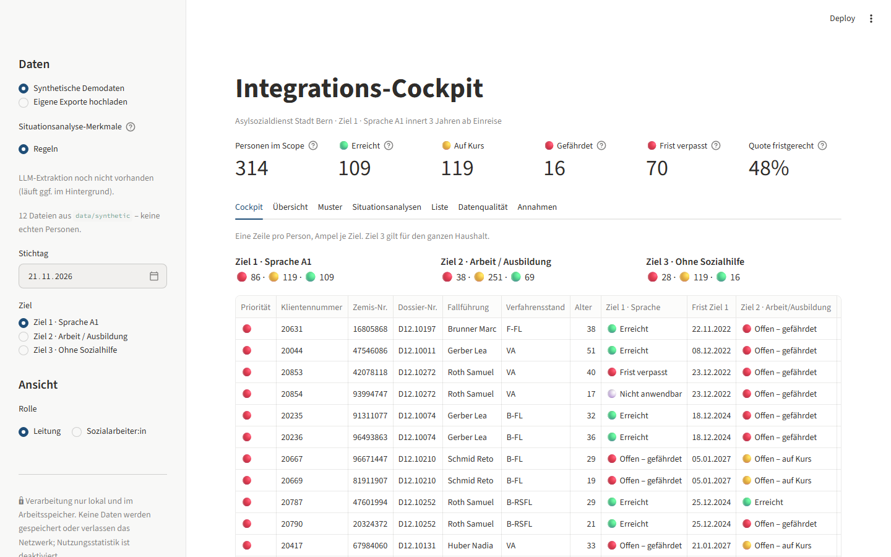

| Zonă | Ce conține |
|---|---|
| **Bara laterală din stânga** | De unde vin datele, Stichtag, obiectivul, rolul tău și descărcarea Excel |
| **Antetul** | Șase indicatori pentru obiectivul ales |
| **Filele** | Vizualizările; ce file vezi depinde de rol |

Cei șase indicatori pentru obiectivul ales:

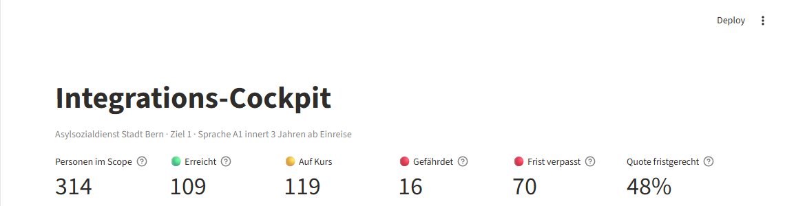

| Indicator | Semnificație |
|---|---|
| Personen im Scope (sau Haushalte im Scope) | Cazurile actuale cărora li se aplică obiectivul |
| 🟢 Erreicht | Atinse; ține mouse-ul pe **?** ca să vezi câte au fost întârziate |
| 🟡 Auf Kurs | Deschise, pe drumul cel bun |
| 🔴 Gefährdet | Deschise, în pericol |
| 🔴 Frist verpasst | Termen ratat |
| Quote fristgerecht | Obiectivul 1: proporția atinsă la timp dintre cazurile scadente. Obiectivele 2 și 3: proporția atinsă la timp dintre cazurile încheiate, inclusiv foști clienți. |

Ține mouse-ul pe orice simbol **?** pentru o explicație.

## 5. Încărcarea datelor

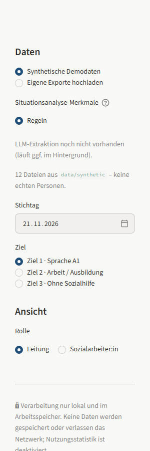

Bara laterală începe cu **Daten** (date). Ea oferă două surse:

- **Synthetische Demodaten** (date demo sintetice): o populație inventată, ca să încerci
  aplicația. Textul de dedesubt confirmă că nu sunt implicate persoane reale.
- **Eigene Exporte hochladen** (încarcă exporturi proprii): exporturile tale reale.

### 5.1 Încărcarea exporturilor reale

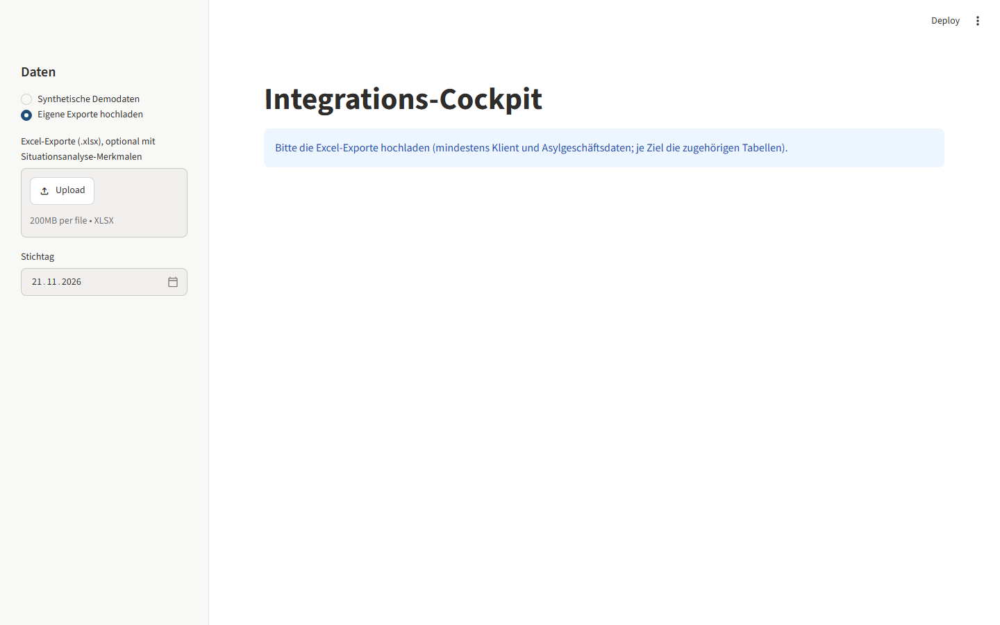

1. Alege **Eigene Exporte hochladen**.
2. Apasă **Upload** sau trage fișierele peste câmp. Selectează **toate fișierele deodată**;
   numele nu contează, pentru că aplicația recunoaște fiecare tabel după coloane.
3. Rezultatele apar imediat ce fișierele sunt citite.

Ce îți trebuie pentru fiecare obiectiv:

| Pentru | Exporturi |
|---|---|
| orice | Klient |
| Obiectivul 1 | Asylgeschäftsdaten, Sprachstand |
| Obiectivul 2 | Erwerb și/sau Integrationsförderung und Ausbildung |
| Obiectivul 3 | Finanzielle Unterstützung |
| Mai multe detalii, tipare, verificări | Dossierperson, Unterbringung, Integrationszielerreichung, ZEMIS Tätigkeit, Asylverfahrensstand |

Dacă lipsesc exporturile unui obiectiv, acesta dispare din selecție, iar bara laterală numește
exporturile lipsă. Celelalte obiective funcționează în continuare.

Poți încărca împreună cu exporturile și un fișier verificat **Situationsanalyse_Merkmale.xlsx**;
vezi [secțiunea 13](#13-situationsanalysen-din-rapoarte-în-text-liber-caracteristici).

### 5.2 Stichtag

**Stichtag** (data de referință) e data pentru care se face evaluarea, implicit ziua de azi.
Alege o dată mai veche ca să vezi cum stăteau lucrurile atunci, sau sfârșitul unei luni pentru
un raport lunar.

## 6. Alegerea obiectivului și a rolului

Mai jos în bara laterală:

- **Ziel** (obiectiv): alege obiectivul 1, 2 sau 3. Indicatorii, *Übersicht*, *Liste* și
  *Muster* urmează această alegere. Fila *Cockpit* arată mereu toate trei obiectivele.
- **Ansicht → Rolle** (vizualizare → rol):
  - **Leitung** (conducere): toate cazurile, plus filele *Muster* și *Situationsanalysen*.
  - **Sozialarbeiter:in** (asistent social): alege-ți numele la **Fallführung** (asistentul
    responsabil de caz). Toți indicatorii și toate tabelele arată atunci doar cazurile tale și
    apare fila **Wen rufe ich an?**.

> Rolul e un mod de afișare, nu o permisiune. Oricine stă la calculator îl poate schimba.

## 7. Pentru asistenții sociali: „Wen rufe ich an?”

„Wen rufe ich an?” înseamnă „pe cine sun?”. Este prima filă în rolul de asistent social.

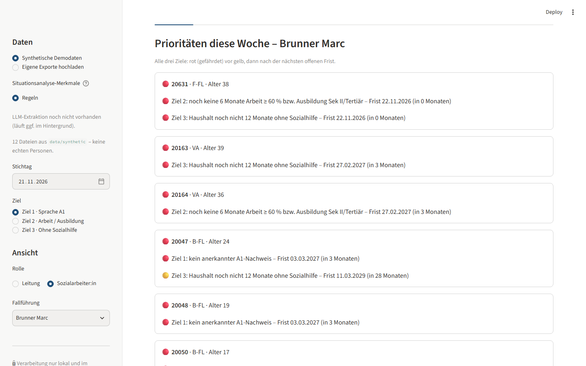

Lista arată până la 15 dintre clienții tăi care au cel puțin un obiectiv **deschis**, sortați
astfel:

1. roșu (în pericol) înaintea galbenului (pe drumul cel bun);
2. la aceeași culoare, cel mai apropiat termen primul.

Fiecare card arată numărul clientului, statutul și vârsta, iar dedesubt câte un rând pentru
fiecare obiectiv deschis: ce lipsește, termenul și câte luni au rămas. Unele rânduri au un
indiciu, de exemplu:

- „Laufende Anstellung ≥ 60 % seit … – Ziel am … erfüllt”: un job de cel puțin 60 % în curs din
  acea dată va îndeplini obiectivul la data arătată.
- „ZEMIS meldet Arbeit ab … – nicht in Erwerb”: registrul federal raportează o muncă ce lipsește
  din exportul *Erwerb*. Înregistreaz-o, iar obiectivul poate fi deja atins.

**Rutina propusă:** deschide lista luni dimineață, lucrează de sus în jos și înregistrează ce
afli în sistemul de gestiune a cazurilor. Următorul export arată efectul.

## 8. Cockpit: toate obiectivele per persoană

Fila **Cockpit** are un rând per persoană, cu statutul și termenul celor trei obiective unul
lângă altul (vezi captura din [secțiunea 4](#4-ecranul-pe-scurt)).

- Deasupra tabelului, fiecare obiectiv are numărul de 🔴 roșii, 🟡 galbene și 🟢 verzi.
- **Priorität** (prioritate) este cel mai rău semafor dintre obiectivele deschise ale persoanei.
- Rândurile sunt sortate după prioritate, apoi după **Nächste offene Frist** (următorul termen
  deschis).
- Obiectivul 3 aparține gospodăriei. Apare pe rândul titularului dosarului, ca o familie să nu
  fie numărată de mai multe ori.

Sfaturi pentru tabele:

- Apasă pe antetul unei coloane ca să sortezi după ea.
- Ține mouse-ul pe tabel și folosește iconițele din dreapta sus ca să cauți, să mărești pe tot
  ecranul sau să descarci tabelul ca CSV.
- Trage marginea unei coloane ca s-o lărgești.

Obiectivul 3 ales, în rolul de conducere:

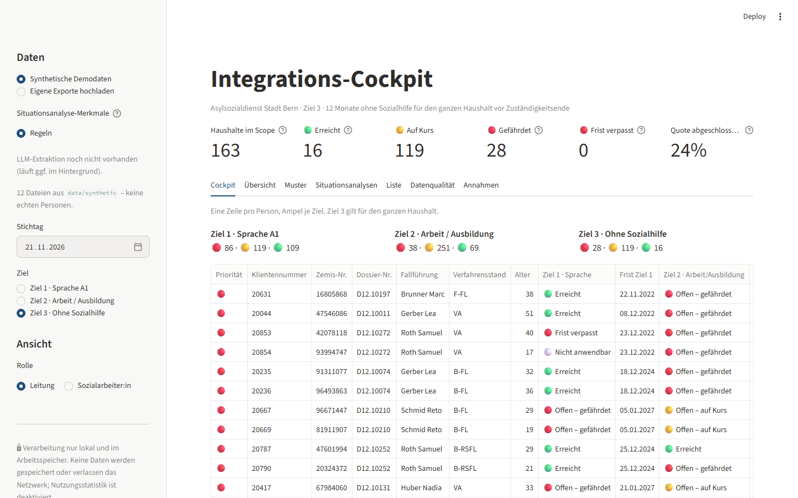

## 9. Übersicht: pe ani de intrare și pe asistenți sociali

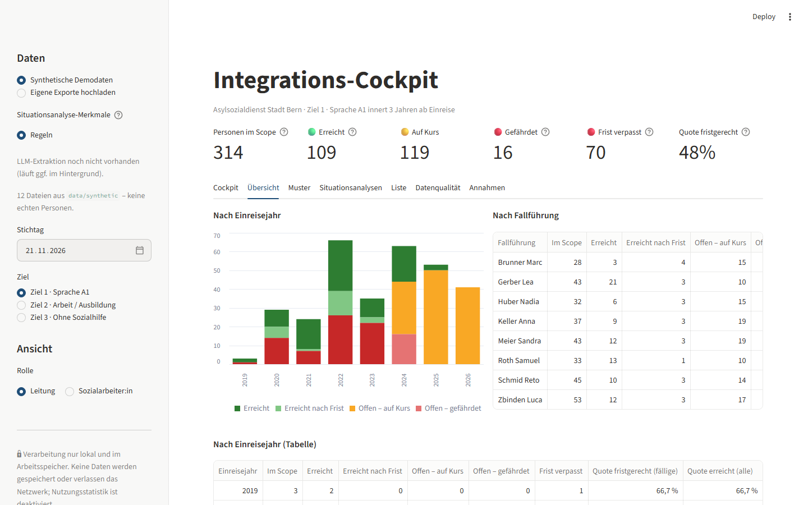

**Übersicht** (prezentare generală) arată obiectivul ales:

- **Nach Einreisejahr** (pe anul intrării): un grafic cu bare al statuturilor pe ani de intrare
  și, mai jos, aceleași cifre într-un tabel;
- **Nach Fallführung** (pe asistent social): un rând per asistent social, cu numărul de cazuri
  pe statut și două rate. În rolul de asistent social devine **Meine Fälle** (cazurile mele).

Cele două rate:

- **Quote fristgerecht (fällige)**: atinse la timp, împărțit la toate cazurile scadente, adică
  atinse sau cu termenul depășit;
- **Quote erreicht (alle)**: atinse, la timp sau cu întârziere, împărțit la toate cazurile din
  perimetru.

## 10. Liste: lista detaliată per obiectiv

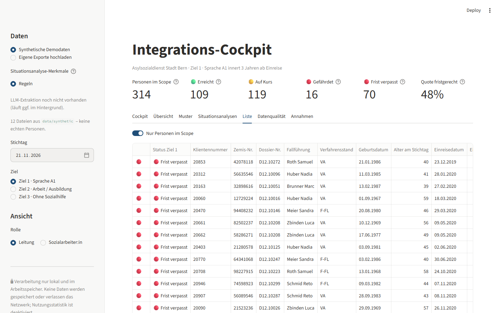

**Liste** (listă) arată un rând per persoană, sau per gospodărie la obiectivul 3, cu toate
detaliile obiectivului ales: date, termen, luni rămase, când și cum a fost atins, sursa datelor
și indicii. Cazurile roșii vin primele.

Dezactivează **Nur Personen im Scope** (doar persoanele din perimetru) ca să vezi și persoanele
cărora obiectivul nu li se aplică. Coloana **Grund nicht anwendbar** (motivul pentru care nu se
aplică) spune atunci de ce: prea tânăr, un statut care nu face parte din obiective,
responsabilitate încheiată, lipsește data intrării etc.

## 11. Datenqualität: ce trebuie corectat și bani de recuperat

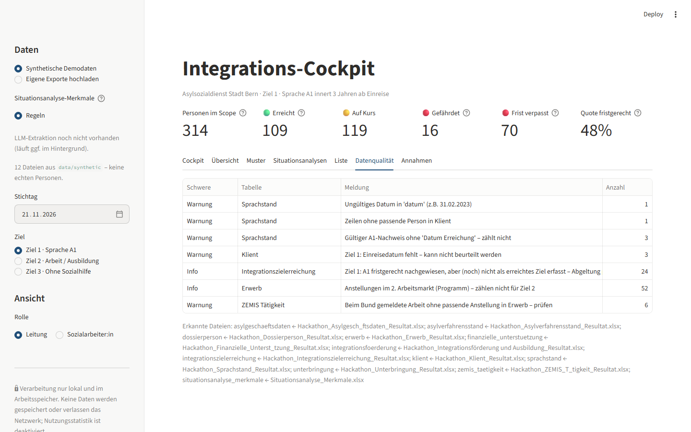

**Datenqualität** (calitatea datelor) listează tot ce a observat aplicația când a citit și a
evaluat datele, cu numărul de cazuri pentru fiecare:

| Gravitate | Semnificație |
|---|---|
| **Fehler** (eroare) | Un fișier nu a putut fi citit sau numere de client apar de două ori; rezultatele pot fi greșite |
| **Warnung** (avertisment) | Date care nu au putut fi folosite: o dată invalidă, lipsa datei intrării, un rând fără client corespunzător |
| **Info** | Bine de știut, sau aduce bani |

Mesajele de rezolvat întâi:

- **„A1 fristgerecht nachgewiesen, aber (noch) nicht als erreichtes Ziel erfasst – Abgeltung
  prüfen”**: A1 a fost dovedit la timp, dar nu a fost înregistrat ca obiectiv atins. Fiecare caz
  e o plată pe care serviciul o poate avea de încasat. Înregistrează obiectivul.
- **„Beim Bund gemeldete Arbeit ohne passende Anstellung in Erwerb – prüfen”**: o muncă știută de
  registrul federal lipsește din exportul *Erwerb*.
- **„Gültiger A1-Nachweis ohne 'Datum Erreichung' – zählt nicht”**: o dovadă A1 validă nu are
  dată, deci nu poate conta. Adaugă data.
- **„Ungültiges Datum”**: o dată invalidă, de exemplu 31.02.2023. Corecteaz-o în sistemul sursă.

Sub tabel, **Erkannte Dateien** (fișiere recunoscute) arată ce fișier încărcat a fost citit ca ce
tabel. Verifică asta ori de câte ori o cifră pare greșită.

## 12. Muster: ce au în comun persoanele care reușesc

*Doar în rolul de conducere.*

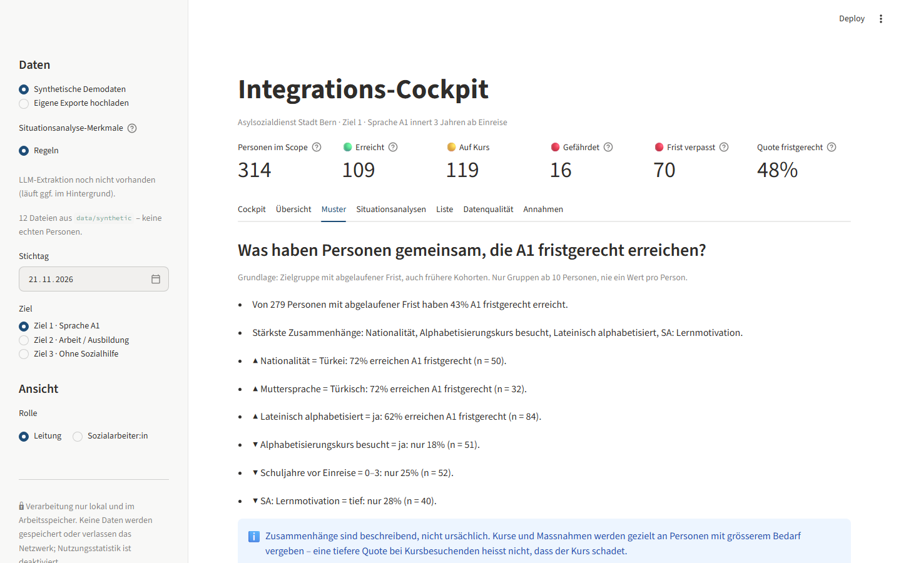

**Muster** (tipare) compară grupuri de persoane al căror termen pentru obiectivul ales a trecut
deja, inclusiv foști clienți, pentru că doar la ele rezultatul e cunoscut. Răspunde la
întrebarea: în ce grupuri au atins obiectivul la timp mai multe, sau mai puține, persoane?

- Punctele de sus rezumă constatările. ▲ marchează un grup care se descurcă peste medie, ▼ unul
  sub medie.
- **Merkmale nach Stärke des Zusammenhangs** (caracteristici după tăria legăturii) ordonează
  caracteristicile. Cu cât bara e mai lungă, cu atât rata de reușită diferă mai mult între
  grupurile acelei caracteristici.
- **Merkmal im Detail** (caracteristica în detaliu): alege o caracteristică ca să vezi rata
  fiecărui grup.

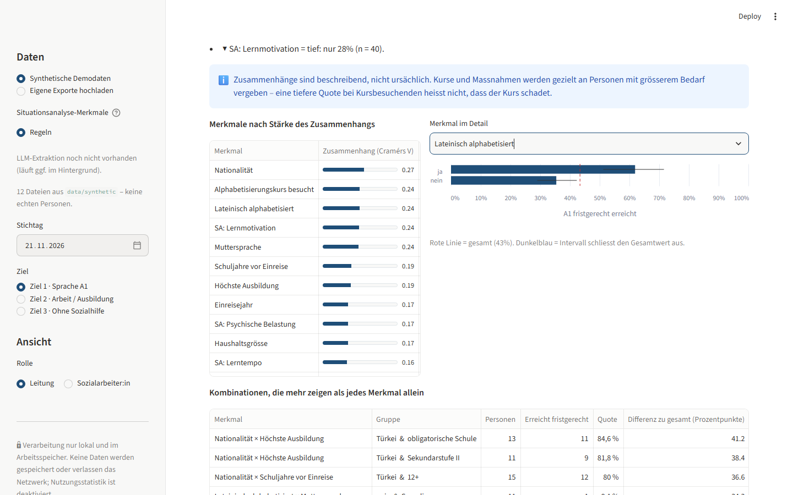

Cum citești graficul:

- fiecare bară e un grup, iar lungimea ei e proporția care a atins obiectivul la timp;
- linia neagră subțire e intervalul de 95 % în care se află probabil valoarea reală;
- linia roșie punctată e media tuturor;
- o bară **albastru-închis** înseamnă că grupul diferă cu adevărat de medie, pentru că
  intervalul lui nu include media; o bară deschisă la culoare poate fi întâmplare.

**Kombinationen** (combinații) listează perechi de caracteristici care împreună spun mai mult
decât fiecare singură, de exemplu o naționalitate combinată cu un nivel de școlarizare.

Reguli pe care te poți baza:

- **Niciun grup sub 10 persoane** nu e afișat vreodată. Grupurile mai mici sunt comasate în
  „Übrige (kleine Gruppen)” (altele, grupuri mici) sau omise.
- **Nicio valoare pentru o persoană individuală** nu apare nicăieri în această filă.
- **O legătură nu e o cauză.** Cursurile ajung la persoanele care au nevoie de mai mult sprijin,
  deci o rată mai mică la participanții la curs nu înseamnă că acesta dăunează. Folosește
  tiparele ca să decizi unde să te uiți mai atent.

## 13. Situationsanalysen: din rapoarte în text liber, caracteristici

*Doar în rolul de conducere.*

Rapoartele *Situationsanalyse* descriu, în text liber, lucruri pe care niciun export nu le
conține: povara psihică, motivația de a învăța, ritmul de învățare, obligațiile de îngrijire a
copiilor, rețeaua socială. Această filă le transformă în cinci caracteristici verificabile per
persoană, care pot fi apoi folosite în *Muster*.

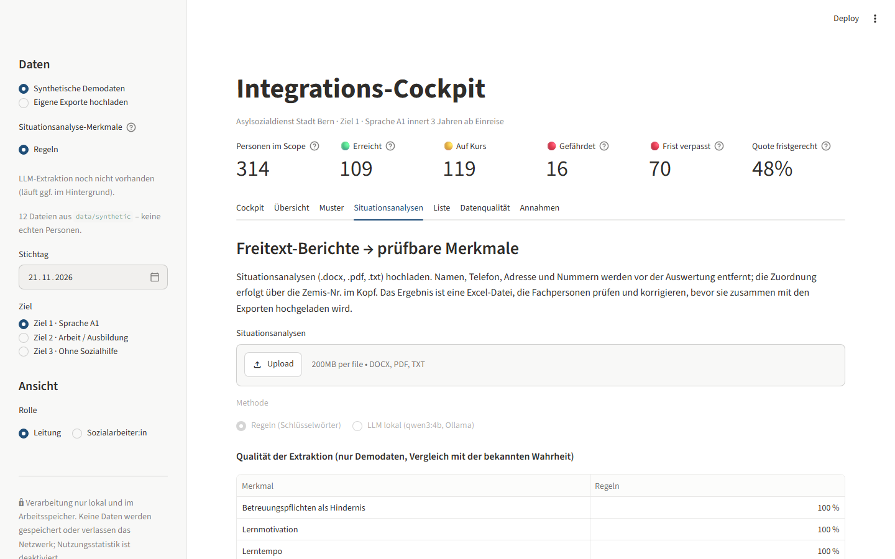

1. Încarcă rapoartele (`.docx`, `.pdf` sau `.txt`) la **Situationsanalysen**. Numele, telefoanele,
   adresele și numerele de identificare sunt eliminate înainte de analiză. Fiecare persoană e
   identificată după numărul Zemis din antetul raportului.
2. Alege **Methode** (metoda):
   - **Regeln (Schlüsselwörter)** (reguli, cuvinte cheie): rapidă; caută formulări cunoscute.
   - **LLM lokal (qwen3:4b, Ollama)**: un model de limbaj care rulează pe acest calculator.
     Citește mai flexibil și are nevoie de aproximativ 20 de secunde per persoană. E disponibil
     doar dacă Ollama e instalat; altfel fila afișează „Lokales LLM nicht erreichbar”.
3. Apasă **Merkmale extrahieren** (extrage caracteristicile). O bară de progres numără
   persoanele.

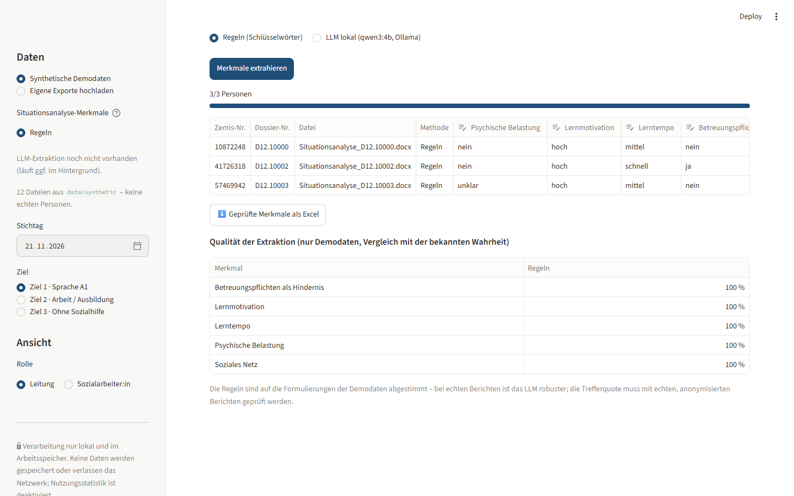

4. **Verifică rezultatul.** Coloanele cu caracteristici sunt editabile: apasă pe o celulă și
   alege altă valoare dacă raportul spune altceva. *unklar* înseamnă că raportul nu spune nimic
   despre acel lucru.
5. Apasă **Geprüfte Merkmale als Excel** (caracteristicile verificate ca Excel) ca să descarci
   fișierul.
6. Data viitoare, încarcă acest fișier **împreună cu exporturile**. Fila *Muster* folosește atunci
   și cele cinci caracteristici, marcate cu *SA:*.

Cu datele demo, fila arată și **Qualität der Extraktion** (calitatea extragerii): cât de des s-a
potrivit fiecare metodă cu adevărul cunoscut. Există doar pentru datele demo, unde adevărul e
cunoscut.

## 14. Annahmen: regulile în vigoare

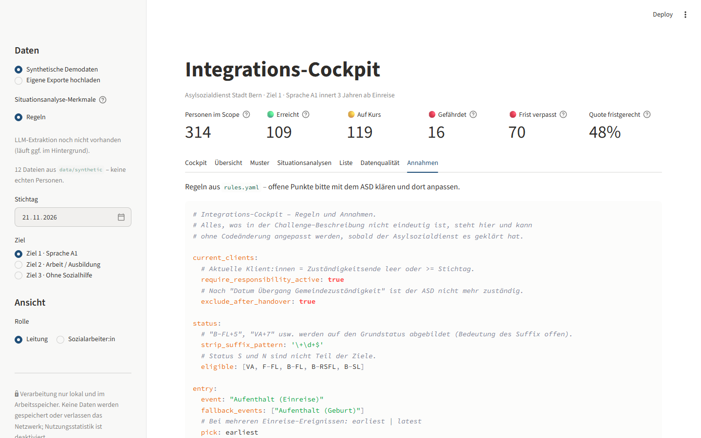

**Annahmen** (ipoteze) arată fișierul `rules.yaml` cu fiecare regulă folosită în evaluare:
termene, vârsta minimă, certificatele de limbă acceptate, pragul de 60 %, ce sprijin înseamnă
ajutor social etc. Comentariile explică fiecare regulă. Punctele lăsate neclare de challenge
sunt marcate ca ipoteze.

Pentru a schimba o regulă, cere-i celui care a instalat aplicația; vezi
[manualul de instalare](instalare.md#61-regulile-de-business-rulesyaml). Regulile în vigoare
sunt scrise și în fiecare rezultat Excel.

## 15. Rezultatul în Excel

Apasă **⬇️ Ergebnis als Excel (alle Ziele)** (rezultatul ca Excel, toate obiectivele) jos în bara
laterală. Numele fișierului conține Stichtag, iar în rolul de asistent social și numele tău.

| Foaie | Conținut |
|---|---|
| Übersicht | Stichtag, indicatorii per obiectiv, din ce fișier vine fiecare tabel |
| Cockpit (alle Ziele) | Un rând per persoană, toate trei obiectivele |
| Ziel 1/2/3 – Personen / Haushalte | Lista detaliată, cu roșiile primele, colorată după semafor |
| Ziel 1/2/3 – Fallführung | Per asistent social |
| Ziel 1/2/3 – Einreisejahr | Per an de intrare |
| Datenqualität | Toate mesajele |
| Annahmen | Regulile în vigoare |
| Muster Z… | Rezultatele analizei tiparelor pentru obiectivul ales (rolul de conducere) |

Fiecare foaie are filtre în rândul de antet și primul rând înghețat. Rândurile sunt colorate
verde, galben, roșu sau gri.

## 16. O lună obișnuită

| Cine | Când | Ce |
|---|---|---|
| Conducerea | Începutul lunii | Exportă toate tabelele, încarcă-le, setează Stichtag la sfârșitul lunii trecute, descarcă rezultatul Excel pentru arhivă |
| Conducerea | În aceeași zi | *Datenqualität*: împarte corecturile și cazurile „Abgeltung prüfen” |
| Asistenții sociali | În fiecare luni | Rolul *Sozialarbeiter:in*, propriul nume, parcurg **Wen rufe ich an?** |
| Conducerea | Trimestrial | *Muster* pentru fiecare obiectiv: unde pierdem oameni, ce sprijin pare să ajute? |

## 17. Glosar

| Termen | Semnificație |
|---|---|
| Stichtag | Data de referință a evaluării |
| Frist | Termenul unui obiectiv |
| Zuständigkeitsende | Data la care se încheie responsabilitatea serviciului pentru un client; termenul pentru obiectivele 2 și 3 |
| Fallführung | Asistentul social responsabil de un caz |
| Dossier / Haushalt | Gospodărie (*Unterstützungseinheit*); obiectivul 3 se evaluează per gospodărie |
| Dossierträger/-in | Titularul dosarului |
| Klientennummer / Zemis-Nr. | Numărul intern de client / numărul din registrul federal |
| VA, F-FL, B-FL, B-RSFL, B-SL | Statuturile cărora li se aplică obiectivele: admiși provizoriu și categoriile de refugiați recunoscuți și apatrizi |
| Im Scope | Un caz actual căruia i se aplică obiectivul |
| Zielgruppe | Obiectivul i se aplică persoanei, fie că e client actual sau nu |
| Abgeltung | Plata pe care serviciul o primește pentru un obiectiv atins |
| Situationsanalyse | Raportul în text liber al asistentului social despre o gospodărie |
| SA: … | O caracteristică extrasă dintr-o Situationsanalyse |

## 18. Întrebări frecvente

**O persoană despre care știu că are A1 apare cu roșu. De ce?**
Deschide *Liste* și uită-te la rândul ei. De obicei dovezii îi lipsește data, are un tip de
dovadă neacceptat (vezi *Annahmen*) sau e înregistrată la alt număr de client. *Datenqualität*
listează astfel de cazuri.

**De ce obiectivul 3 are mai puține cazuri decât obiectivele 1 și 2?**
Obiectivul 3 numără gospodării, nu persoane.

**O persoană e gri, „Nicht anwendbar”.**
Fila *Liste*, cu *Nur Personen im Scope* dezactivat, arată motivul în coloana
*Grund nicht anwendbar*.

**O regulă a fost schimbată și cifrele nu s-au modificat.**
Reîncarcă pagina. Fila *Annahmen* arată regulile în vigoare; dacă arată încă valoarea veche,
fișierul nu a fost salvat.

**Se salvează datele undeva?**
Nu. La închiderea browserului totul se pierde. Păstrează rezultatul Excel dacă ai nevoie de o
evidență și păstrează-l ca pe orice alt fișier cu date personale.

**Pot folosi aplicația de acasă sau de pe telefon?**
Nu. Rulează doar pe calculatorul pe care e instalată.
